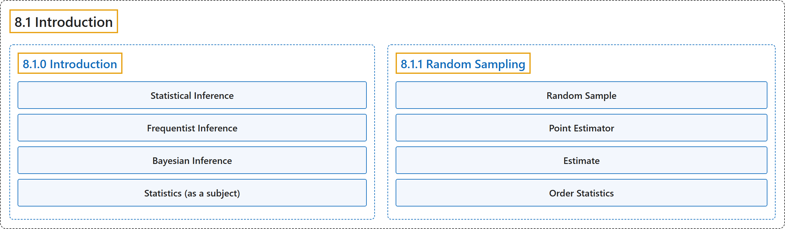

# 8.1 Introduction

## Classification

## Glossary

| Term | Definition | 中文翻译 | Source |
|---|---|---|---|
| **8.1 Introduction** 介绍 | (No definition) | （无定义） | [Pishro-Nik, 2014, section 8.1](https://www.probabilitycourse.com/chapter8/8_1_0_intro.php) |
| **8.1.0 Introduction** 介绍 | (No definition) | （无定义） | [Pishro-Nik, 2014, section 8.1.0](https://www.probabilitycourse.com/chapter8/8_1_0_intro.php) |
| **Statistical Inference** 统计推断 | "**Statistical inference** is a collection of methods that deal with drawing conclusions from data that are prone to random variation." | **统计推断**是一组方法，用于从易受随机变异影响的数据中得出结论。 | [Pishro-Nik, 2014, section 8.1.0](https://www.probabilitycourse.com/chapter8/8_1_0_intro.php#:~:text=Statistical%20inference%20is%20a%20collection%20of) |
| **Frequentist Inference** 频率学派推断 | "In this approach, the unknown quantity $\theta$ is assumed to be a **fixed quantity**. That is, $\theta$ is a **deterministic** (non-random) quantity that is to be estimated by the observed data." | 在这种方法中，未知量 $\theta$ 被假定为**固定量**。也就是说，$\theta$ 是一个**确定性的**（非随机的）量，需要由观测数据来估计。 | [Pishro-Nik, 2014, section 8.1.0](https://www.probabilitycourse.com/chapter8/8_1_0_intro.php#:~:text=In%20this%20approach%2C%20the%20unknown%20quantity) |
| **Bayesian Inference** 贝叶斯推断 | "In the Bayesian approach the unknown quantity $\Theta$ is assumed to be a **random variable**, and we assume that we have some initial guess about the distribution of $\Theta$. After observing the data, we update the distribution of $\Theta$ using **Bayes' Rule**." | 在贝叶斯方法中，未知量 $\Theta$ 被假定为**随机变量**，并假定我们对 $\Theta$ 的分布有某种初始猜测。观测到数据后，我们利用**贝叶斯法则**更新 $\Theta$ 的分布。 | [Pishro-Nik, 2014, section 8.1.0](https://www.probabilitycourse.com/chapter8/8_1_0_intro.php#:~:text=In%20the%20Bayesian%20approach%20the%20unknown) |
| **Statistics (as a subject)** 统计（作为学科） | "The mathematical study of the **likelihood and probability of events** occurring based on known information and inferred by **taking a limited number of samples**." | 对事件发生的**可能性和概率**所作的数学研究，依据已知信息，并通过**抽取有限数量的样本**来推断。 | [Weisstein, n.d., "Statistics" entry, para. 1](https://mathworld.wolfram.com/Statistics.html#:~:text=The%20mathematical%20study%20of%20the%20likelihood%20and%20probability%20of%20events) |
| **8.1.1 Random Sampling** 随机抽样 | (No definition) | （无定义） | [Pishro-Nik, 2014, section 8.1.1](https://www.probabilitycourse.com/chapter8/8_1_1_random_sampling.php) |
| **Random Sample** 随机样本 | "The collection of random variables $X_1$, $X_2$, $X_3$, $...$, $X_n$ is said to be a **random sample** of size $n$ if they are independent and identically distributed (i.i.d.)," | 若随机变量集合 $X_1$, $X_2$, $X_3$, $...$, $X_n$ 独立同分布（i.i.d.），则称其为容量为 $n$ 的**随机样本**， | [Pishro-Nik, 2014, section 8.1.1](https://www.probabilitycourse.com/chapter8/8_1_1_random_sampling.php#:~:text=The%20collection%20of%20random%20variables%20%2C) |
| **Point Estimator** 点估计量 | "In general, a **point estimator** is a function of the random sample $\hat{\Theta}=h(X_1,X_2,\cdots,X_n)$ that is used to estimate an unknown quantity." | 一般地，**点估计量**是随机样本的函数 $\hat{\Theta}=h(X_1,X_2,\cdots,X_n)$，用来估计未知量。 | [Pishro-Nik, 2014, section 8.1.1](https://www.probabilitycourse.com/chapter8/8_1_1_random_sampling.php#:~:text=In%20general%2C%20a%20point%20estimator%20is) |
| **Estimate** 估计值 | "Here, $\hat{\theta}$ is called an **estimate** of the average height in the population." | 这里 $\hat{\theta}$ 称为总体平均身高的**估计值**。 | [Pishro-Nik, 2014, section 8.1.1](https://www.probabilitycourse.com/chapter8/8_1_1_random_sampling.php#:~:text=Here%2C%20is%20called%20an%20estimate%20of) |
| **Order Statistics** 顺序统计量 | "Thus, we often order the observed data from the smallest to the largest. We call the resulting ordered random variables **order statistics**." | 因此，我们常把观测数据从小到大排序。我们把得到的有序随机变量称为**顺序统计量**。 | [Pishro-Nik, 2014, section 8.1.1](https://www.probabilitycourse.com/chapter8/8_1_1_random_sampling.php#:~:text=Thus%2C%20we%20often%20order%20the%20observed) |

## References

Pishro-Nik, H. (2014). *Introduction to probability, statistics, and random processes*. Kappa Research. Retrieved October 28, 2026, from <https://www.probabilitycourse.com/>

Weisstein, E. W. (n.d.). *Statistics*. MathWorld: A Wolfram Resource. Retrieved October 27, 2026, from <https://mathworld.wolfram.com/Statistics.html>
