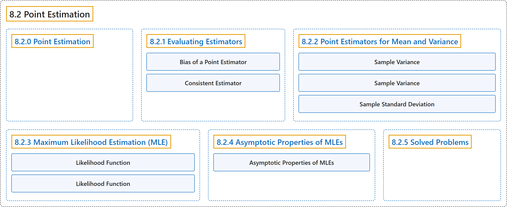

# 8.2 Point Estimation

## Classification

## Glossary

| Term | Definition | 中文翻译 | Source |
|---|---|---|---|
| **8.2 Point Estimation** 点估计 | (No definition) | （无定义） | [Pishro-Nik, 2014, section 8.2](https://www.probabilitycourse.com/chapter8/8_2_0_point_estimation.php) |
| **8.2.0 Point Estimation** 点估计 | (No definition) | （无定义） | [Pishro-Nik, 2014, section 8.2.0](https://www.probabilitycourse.com/chapter8/8_2_0_point_estimation.php) |
| **8.2.1 Evaluating Estimators** 评价估计量 | (No definition) | （无定义） | [Pishro-Nik, 2014, section 8.2.1](https://www.probabilitycourse.com/chapter8/8_2_1_evaluating_estimators.php) |
| **Bias of a Point Estimator** 点估计量的偏差 | "Let $\hat{\Theta}=h(X_1,X_2,\cdots,X_n)$ be a point estimator for $\theta$. The **bias** of point estimator $\hat{\Theta}$ is defined by" | 设 $\hat{\Theta}=h(X_1,X_2,\cdots,X_n)$ 为 $\theta$ 的点估计量。点估计量 $\hat{\Theta}$ 的**偏差**定义为 | [Pishro-Nik, 2014, section 8.2.1](https://www.probabilitycourse.com/chapter8/8_2_1_evaluating_estimators.php#:~:text=Let%20be%20a%20point%20estimator%20for) |
| **Consistent Estimator** 相合估计量 | "then $\hat{\Theta}_n$ is a **consistent estimator** of $\theta$." | 则 $\hat{\Theta}_n$ 是 $\theta$ 的**相合估计量**。 | [Pishro-Nik, 2014, section 8.2.1](https://www.probabilitycourse.com/chapter8/8_2_1_evaluating_estimators.php#:~:text=then%20is%20a%20consistent%20estimator%20of) |
| **8.2.2 Point Estimators for Mean and Variance** 均值与方差的点估计量 | (No definition) | （无定义） | [Pishro-Nik, 2014, section 8.2.2](https://www.probabilitycourse.com/chapter8/8_2_2_point_estimators_for_mean_and_var.php) |
| **Sample Variance** 样本方差 | "The **sample variance** of this random sample is defined as" | 该随机样本的**样本方差**定义为 | [Pishro-Nik, 2014, section 8.2.2](https://www.probabilitycourse.com/chapter8/8_2_2_point_estimators_for_mean_and_var.php#:~:text=The%20sample%20variance%20of%20this%20random) |
| **Sample Variance** 样本方差 | "By the above discussion, $S^2$ is an unbiased estimator of the variance. We call it the **sample variance**." | 由上述讨论，$S^2$ 是方差的无偏估计量。我们称之为**样本方差**。 | [Pishro-Nik, 2014, section 8.2.2](https://www.probabilitycourse.com/chapter8/8_2_2_point_estimators_for_mean_and_var.php#:~:text=By%20the%20above%20discussion%2C%20is%20an) |
| **Sample Standard Deviation** 样本标准差 | "We also define the **sample standard deviation** as" | 我们还把**样本标准差**定义为 | [Pishro-Nik, 2014, section 8.2.2](https://www.probabilitycourse.com/chapter8/8_2_2_point_estimators_for_mean_and_var.php#:~:text=We%20also%20define%20the%20sample%20standard) |
| **8.2.3 Maximum Likelihood Estimation (MLE)** 最大似然估计（MLE） | (No definition) | （无定义） | [Pishro-Nik, 2014, section 8.2.3](https://www.probabilitycourse.com/chapter8/8_2_3_max_likelihood_estimation.php) |
| **Likelihood Function** 似然函数 | "If $X_i$'s are discrete, then the **likelihood function** is defined as" | 若 $X_i$ 为离散型，则**似然函数**定义为 | [Pishro-Nik, 2014, section 8.2.3](https://www.probabilitycourse.com/chapter8/8_2_3_max_likelihood_estimation.php#:~:text=If%20%27s%20are%20discrete%2C%20then%20the) |
| **Likelihood Function** 似然函数 | "If $X_i$'s are discrete random variables, we define the **likelihood function** as the **probability of the observed sample** as a function of $\theta$:" | 如果 $X_i$ 是离散随机变量，我们把**似然函数**定义为**观测样本的概率**，视为 $\theta$ 的函数： | [Pishro-Nik, 2014, section 8.2.3](https://www.probabilitycourse.com/chapter8/8_2_3_max_likelihood_estimation.php#:~:text=If%20%27s%20are%20discrete%20random%20variables%2C) |
| **8.2.4 Asymptotic Properties of MLEs** 最大似然估计量的渐近性质 | (No definition) | （无定义） | [Pishro-Nik, 2014, section 8.2.4](https://www.probabilitycourse.com/chapter8/8_2_4_asymptotic_probs_of_MLE.php) |
| **Asymptotic Properties of MLEs** 最大似然估计的渐近性质 | "Let $\hat{\Theta}_{ML}$ denote the **maximum likelihood estimator (MLE)** of $\theta$. Then, under some mild regularity conditions, $\hat{\Theta}_{ML}$ is **asymptotically consistent**, i.e.," | 设 $\hat{\Theta}_{ML}$ 表示 $\theta$ 的**最大似然估计量**（MLE）。则在一些温和的正则条件下，$\hat{\Theta}_{ML}$ 是**渐近一致的**，即 | [Pishro-Nik, 2014, section 8.2.4](https://www.probabilitycourse.com/chapter8/8_2_4_asymptotic_probs_of_MLE.php#:~:text=Let%20denote%20the%20maximum%20likelihood%20estimator) |
| **8.2.5 Solved Problems** 例题详解 | (No definition) | （无定义） | [Pishro-Nik, 2014, section 8.2.5](https://www.probabilitycourse.com/chapter8/8_2_5_solved_probs.php) |

## References

Pishro-Nik, H. (2014). *Introduction to probability, statistics, and random processes*. Kappa Research. Retrieved October 28, 2026, from <https://www.probabilitycourse.com/>
