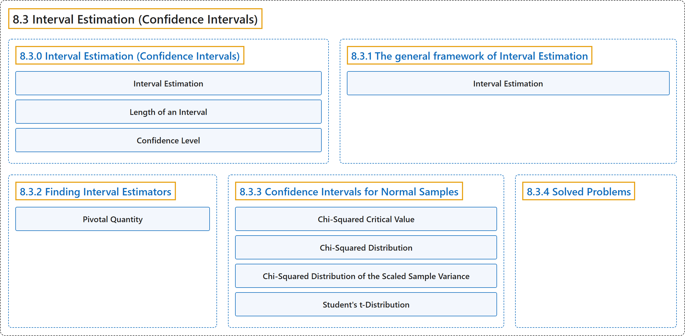

# 8.3 Interval Estimation (Confidence Intervals)

## Classification

## Glossary

| Term | Definition | 中文翻译 | Source |
|---|---|---|---|
| **8.3 Interval Estimation (Confidence Intervals)** 区间估计（置信区间） | (No definition) | （无定义） | [Pishro-Nik, 2014, section 8.3](https://www.probabilitycourse.com/chapter8/8_3_0_interval_estimation.php) |
| **8.3.0 Interval Estimation (Confidence Intervals)** 区间估计（置信区间） | (No definition) | （无定义） | [Pishro-Nik, 2014, section 8.3.0](https://www.probabilitycourse.com/chapter8/8_3_0_interval_estimation.php) |
| **Interval Estimation** 区间估计 | "Here, we will introduce the concept of **interval estimation**. In this approach, instead of giving just one value $\hat{\theta}$ as the estimate for $\theta$, we will produce an **interval** that is likely to include the true value of $\theta$." | 这里我们引入**区间估计**的概念。在这种方法中，我们不只给出一个值 $\hat{\theta}$ 作为 $\theta$ 的估计，而是给出一个很可能包含 $\theta$ 真值的**区间**。 | [Pishro-Nik, 2014, section 8.3.0](https://www.probabilitycourse.com/chapter8/8_3_0_interval_estimation.php#:~:text=Here%2C%20we%20will%20introduce%20the%20concept) |
| **Length of an Interval** 区间长度 | "One is the **length** of the reported interval, $\hat{\theta}_h-\hat{\theta}_l$. The length of the interval shows the **precision** with which we can estimate $\theta$." | 其一是所报告区间的**长度** $\hat{\theta}_h-\hat{\theta}_l$。区间长度反映了我们估计 $\theta$ 的**精度**。 | [Pishro-Nik, 2014, section 8.3.0](https://www.probabilitycourse.com/chapter8/8_3_0_interval_estimation.php#:~:text=One%20is%20the%20length%20of%20the) |
| **Confidence Level** 置信水平 | "The second important factor is the **confidence level** that shows how confident we are about the interval. The confidence level is the **probability** that the interval that we construct includes the real value of $\theta$." | 第二个重要因素是**置信水平**，它表明我们对该区间有多大把握。置信水平是我们构造的区间包含 $\theta$ 真值的**概率**。 | [Pishro-Nik, 2014, section 8.3.0](https://www.probabilitycourse.com/chapter8/8_3_0_interval_estimation.php#:~:text=The%20second%20important%20factor%20is%20the) |
| **8.3.1 The general framework of Interval Estimation** 区间估计的一般框架 | (No definition) | （无定义） | [Pishro-Nik, 2014, section 8.3.1](https://www.probabilitycourse.com/chapter8/8_3_1_gen_framework_of_int_estimation.php) |
| **Interval Estimation** 区间估计 | "An **interval estimator** with confidence level $1-\alpha$ consists of two estimators $\hat{\Theta}_l(X_1, X_2, \cdots, X_n)$ and $\hat{\Theta}_h(X_1, X_2, \cdots, X_n)$ such that" | 置信水平为 $1-\alpha$ 的**区间估计量**由两个估计量 $\hat{\Theta}_l(X_1, X_2, \cdots, X_n)$ 和 $\hat{\Theta}_h(X_1, X_2, \cdots, X_n)$ 构成，使得 | [Pishro-Nik, 2014, section 8.3.1](https://www.probabilitycourse.com/chapter8/8_3_1_gen_framework_of_int_estimation.php#:~:text=An%20interval%20estimator%20with%20confidence%20level) |
| **8.3.2 Finding Interval Estimators** 求区间估计量 | (No definition) | （无定义） | [Pishro-Nik, 2014, section 8.3.2](https://www.probabilitycourse.com/chapter8/8_3_2_finding_interval_estimators.php) |
| **Pivotal Quantity** 枢轴量 | "The random variable $Q$ is said to be a **pivot** or a **pivotal quantity**, if it has the following properties:" | 如果随机变量 $Q$ 具有下列性质，则称它是**枢轴**（pivot）或**枢轴量**： | [Pishro-Nik, 2014, section 8.3.2](https://www.probabilitycourse.com/chapter8/8_3_2_finding_interval_estimators.php#:~:text=The%20random%20variable%20is%20said%20to) |
| **8.3.3 Confidence Intervals for Normal Samples** 正态样本的置信区间 | (No definition) | （无定义） | [Pishro-Nik, 2014, section 8.3.3](https://www.probabilitycourse.com/chapter8/8_3_3_confidence_intervals_for_norm_samples.php) |
| **Chi-Squared Critical Value** 卡方临界值 | "For any $p \in [0,1]$ and $n \in \mathbb{N}$, we define $\chi^2_{p,n}$ as the **real value** for which" | 对任意 $p \in [0,1]$ 和 $n \in \mathbb{N}$，我们把 $\chi^2_{p,n}$ 定义为满足下式的**实数值** | [Pishro-Nik, 2014, section 8.3.3](https://www.probabilitycourse.com/chapter8/8_3_3_confidence_intervals_for_norm_samples.php#:~:text=For%20any%20and%20%2C%20we%20define) |
| **Chi-Squared Distribution** 卡方分布 | "is said to have a **chi-squared distribution** with $n$ **degrees of freedom** shown by" | 称为服从自由度为 $n$ 的**卡方分布**，其**自由度**记作 | [Pishro-Nik, 2014, section 8.3.3](https://www.probabilitycourse.com/chapter8/8_3_3_confidence_intervals_for_norm_samples.php#:~:text=is%20said%20to%20have%20a%20chi-squared) |
| **Chi-Squared Distribution of the Scaled Sample Variance** 正态样本方差的卡方分布 | "has a **chi-squared distribution** with $n-1$ degrees of freedom, i.e., $Y \sim \chi^2(n-1)$. Moreover, $\overline{X}$ and $S^2$ are **independent** random variables." | 服从自由度为 $n-1$ 的**卡方分布**，即 $Y \sim \chi^2(n-1)$。此外，$\overline{X}$ 与 $S^2$ 是相互**独立**的随机变量。 | [Pishro-Nik, 2014, section 8.3.3](https://www.probabilitycourse.com/chapter8/8_3_3_confidence_intervals_for_norm_samples.php#:~:text=has%20a%20chi-squared%20distribution%20with%20degrees) |
| **Student's t-Distribution** 学生t分布 | "is said to have a $t$-distribution with $n$ **degrees of freedom** shown by" | 称为服从自由度为 $n$ 的 $t$ 分布，其**自由度**记作 | [Pishro-Nik, 2014, section 8.3.3](https://www.probabilitycourse.com/chapter8/8_3_3_confidence_intervals_for_norm_samples.php#:~:text=is%20said%20to%20have%20a%20-distribution) |
| **8.3.4 Solved Problems** 例题详解 | (No definition) | （无定义） | [Pishro-Nik, 2014, section 8.3.4](https://www.probabilitycourse.com/chapter8/8_3_4_solved_probs.php) |

## References

Pishro-Nik, H. (2014). *Introduction to probability, statistics, and random processes*. Kappa Research. Retrieved October 28, 2026, from <https://www.probabilitycourse.com/>
