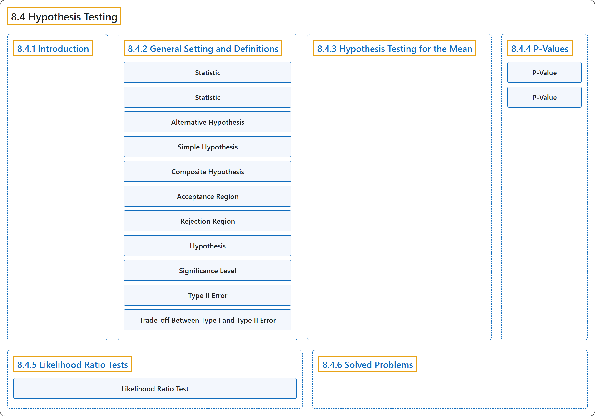

# 8.4 Hypothesis Testing

## Classification

## Glossary

| Term | Definition | 中文翻译 | Source |
|---|---|---|---|
| **8.4 Hypothesis Testing** 假设检验 | (No definition) | （无定义） | [Pishro-Nik, 2014, section 8.4](https://www.probabilitycourse.com/chapter8/8_4_1_intro.php) |
| **8.4.1 Introduction** 介绍 | (No definition) | （无定义） | [Pishro-Nik, 2014, section 8.4.1](https://www.probabilitycourse.com/chapter8/8_4_1_intro.php) |
| **8.4.2 General Setting and Definitions** 一般设定与定义 | (No definition) | （无定义） | [Pishro-Nik, 2014, section 8.4.2](https://www.probabilitycourse.com/chapter8/8_4_2_general_setting_definitions.php) |
| **Statistic** 统计量 | "A **statistic** is a real-valued function of the data." | **统计量**是数据的实值函数。 | [Pishro-Nik, 2014, section 8.4.2](https://www.probabilitycourse.com/chapter8/8_4_2_general_setting_definitions.php#:~:text=A%20statistic%20is%20a%20real-valued%20function) |
| **Statistic** 统计量 | "A **statistic** is a **real-valued function** of the data." | **统计量**是数据的**实值函数**。 | [Pishro-Nik, 2014, section 8.4.2](https://www.probabilitycourse.com/chapter8/8_4_2_general_setting_definitions.php#:~:text=A%20statistic%20is%20a%20real-valued%20function) |
| **Alternative Hypothesis** 备择假设 | "$H_0$ (the **null hypothesis**): $\theta \in S_0$. $\quad$ $H_1$ (the **alternative hypothesis**): $\theta \in S_1$." | $H_0$（**原假设**）：$\theta \in S_0$。$\quad$ $H_1$（**备择假设**）：$\theta \in S_1$。 | [Pishro-Nik, 2014, section 8.4.2](https://www.probabilitycourse.com/chapter8/8_4_2_general_setting_definitions.php#:~:text=%28the%20null%20hypothesis%29%3A%20.%20%28the%20alternative) |
| **Simple Hypothesis** 简单假设 | "Here, $H_0$ is an example of a **simple hypothesis** because $S_0$ contains only one value of $\theta$." | 这里，$H_0$ 是**简单假设**的一个例子，因为 $S_0$ 只包含 $\theta$ 的一个值。 | [Pishro-Nik, 2014, section 8.4.2](https://www.probabilitycourse.com/chapter8/8_4_2_general_setting_definitions.php#:~:text=Here%2C%20is%20an%20example%20of%20a) |
| **Composite Hypothesis** 复合假设 | "On the other hand, $H_1$ is an example of **composite hypothesis** since $S_1$ contains more than one element." | 另一方面，$H_1$ 是**复合假设**的一个例子，因为 $S_1$ 包含不止一个元素。 | [Pishro-Nik, 2014, section 8.4.2](https://www.probabilitycourse.com/chapter8/8_4_2_general_setting_definitions.php#:~:text=On%20the%20other%20hand%2C%20is%20an) |
| **Acceptance Region** 接受域 | "The set $A$ is called the **acceptance region**, while the set $R=\mathbb{R}-A$ is said to be the rejection region." | 集合 $A$ 称为**接受域**，而集合 $R=\mathbb{R}-A$ 称为拒绝域。 | [Pishro-Nik, 2014, section 8.4.2](https://www.probabilitycourse.com/chapter8/8_4_2_general_setting_definitions.php#:~:text=The%20set%20is%20called%20the%20acceptance) |
| **Rejection Region** 拒绝域 | "The set $A$ is called the acceptance region, while the set $R=\mathbb{R}-A$ is said to be the **rejection region**." | 集合 $A$ 称为接受域，而集合 $R=\mathbb{R}-A$ 称为**拒绝域**。 | [Pishro-Nik, 2014, section 8.4.2](https://www.probabilitycourse.com/chapter8/8_4_2_general_setting_definitions.php#:~:text=The%20set%20is%20called%20the%20acceptance) |
| **Hypothesis** 假设 | "A hypothesis is a statement such as $\theta=1$, $\theta>1.3$, $\theta \neq 0.5$, etc. In hypothesis testing problems, we need to decide between two **contradictory hypotheses**." | 假设是形如 $\theta=1$、$\theta>1.3$、$\theta \neq 0.5$ 等的陈述。在假设检验问题中，我们需要在两个**相互矛盾的假设**之间做出决定。 | [Pishro-Nik, 2014, section 8.4.2](https://www.probabilitycourse.com/chapter8/8_4_2_general_setting_definitions.php#:~:text=A%20hypothesis%20is%20a%20statement%20such) |
| **Significance Level** 显著性水平 | "then we say the test has **significance level** $\alpha$ or simply the test is a **level** $\alpha$ **test**." | 则称该检验的**显著性水平**为 $\alpha$，或简称该检验是**水平** $\alpha$ **检验**。 | [Pishro-Nik, 2014, section 8.4.2](https://www.probabilitycourse.com/chapter8/8_4_2_general_setting_definitions.php#:~:text=then%20we%20say%20the%20test%20has) |
| **Type II Error** 第二类错误 | "The second possible error that we can make is to accept $H_0$ when $H_0$ is false. This is called the **type II error**." | 我们可能犯的第二种错误是在 $H_0$ 为假时接受 $H_0$。这称为**第二类错误**。 | [Pishro-Nik, 2014, section 8.4.2](https://www.probabilitycourse.com/chapter8/8_4_2_general_setting_definitions.php#:~:text=The%20second%20possible%20error%20that%20we) |
| **Trade-off Between Type I and Type II Error** 第一类与第二类错误的权衡 | "However, there is in fact a **trade-off** between $\alpha$ and $\beta$. That is, if we want to decrease the probability of type I error ($\alpha$), then the probability of type II error ($\beta$) **increases**, and vise versa." | 然而，$\alpha$ 与 $\beta$ 之间实际上存在**权衡**。也就是说，如果我们想减小第一类错误的概率（$\alpha$），则第二类错误的概率（$\beta$）会**增大**，反之亦然。 | [Pishro-Nik, 2014, section 8.4.2](https://www.probabilitycourse.com/chapter8/8_4_2_general_setting_definitions.php#:~:text=However%2C%20there%20is%20in%20fact%20a) |
| **8.4.3 Hypothesis Testing for the Mean** 均值的假设检验 | (No definition) | （无定义） | [Pishro-Nik, 2014, section 8.4.3](https://www.probabilitycourse.com/chapter8/8_4_3_hypothesis_testing_for_mean.php) |
| **8.4.4 P-Values** P值 | (No definition) | （无定义） | [Pishro-Nik, 2014, section 8.4.4](https://www.probabilitycourse.com/chapter8/8_4_4_p_vals.php) |
| **P-Value** P 值 | "**P-value** is the lowest **significance level** $\alpha$ that results in rejecting the null hypothesis." | **P 值**是导致拒绝原假设的最低**显著性水平** $\alpha$。 | [Pishro-Nik, 2014, section 8.4.4](https://www.probabilitycourse.com/chapter8/8_4_4_p_vals.php#:~:text=P-value%20is%20the%20lowest%20significance%20level) |
| **P-Value** P值 | "The $P$-value is $P(\textrm{type I error})$ when the **test threshold** $c$ is chosen to be $c=w_1$." | 当**检验阈值** $c$ 取为 $c=w_1$ 时，$P$ 值就是 $P(\textrm{type I error})$。 | [Pishro-Nik, 2014, section 8.4.4](https://www.probabilitycourse.com/chapter8/8_4_4_p_vals.php#:~:text=The%20-value%20is%20when%20the%20test) |
| **8.4.5 Likelihood Ratio Tests** 似然比检验 | (No definition) | （无定义） | [Pishro-Nik, 2014, section 8.4.5](https://www.probabilitycourse.com/chapter8/8_4_5_likelihood_ratio_tests.php) |
| **Likelihood Ratio Test** 似然比检验 | "To perform a **likelihood ratio test** (LRT), we choose a constant $c$. We reject $H_0$ if $\lambda \lt c$ and accept it if $\lambda \geq c$." | 为进行**似然比检验**（LRT），我们选取一个常数 $c$。若 $\lambda \lt c$ 则拒绝 $H_0$，若 $\lambda \geq c$ 则接受 $H_0$。 | [Pishro-Nik, 2014, section 8.4.5](https://www.probabilitycourse.com/chapter8/8_4_5_likelihood_ratio_tests.php#:~:text=To%20perform%20a%20likelihood%20ratio%20test) |
| **8.4.6 Solved Problems** 例题详解 | (No definition) | （无定义） | [Pishro-Nik, 2014, section 8.4.6](https://www.probabilitycourse.com/chapter8/8_4_6_solved_probs.php) |

## References

Pishro-Nik, H. (2014). *Introduction to probability, statistics, and random processes*. Kappa Research. Retrieved October 28, 2026, from <https://www.probabilitycourse.com/>
