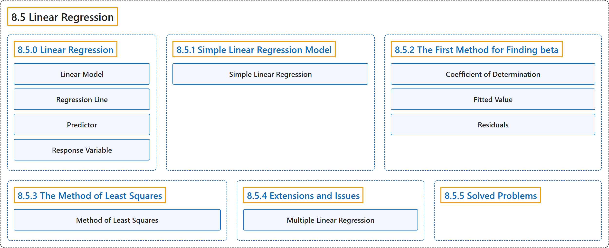

# 8.5 Linear Regression

## Classification

## Glossary

| Term | Definition | 中文翻译 | Source |
|---|---|---|---|
| **8.5 Linear Regression** 线性回归 | (No definition) | （无定义） | [Pishro-Nik, 2014, section 8.5](https://www.probabilitycourse.com/chapter8/8_5_0_linear_regression.php) |
| **8.5.0 Linear Regression** 线性回归 | (No definition) | （无定义） | [Pishro-Nik, 2014, section 8.5.0](https://www.probabilitycourse.com/chapter8/8_5_0_linear_regression.php) |
| **Linear Model** 线性模型 | "A **linear model** is probably the simplest model that we can define, where we write" | **线性模型**可能是我们能定义的最简单的模型，其中我们写作 | [Pishro-Nik, 2014, section 8.5.0](https://www.probabilitycourse.com/chapter8/8_5_0_linear_regression.php#:~:text=A%20linear%20model%20is%20probably%20the) |
| **Regression Line** 回归直线 | "is called the **regression line**." | 称为**回归直线**。 | [Pishro-Nik, 2014, section 8.5.0](https://www.probabilitycourse.com/chapter8/8_5_0_linear_regression.php#:~:text=is%20called%20the%20regression%20line.) |
| **Predictor** 预测变量 | "The variable $x$ is called the **predictor** or the **explanatory variable**, and the random variable $Y$ is called the response variable." | 变量 $x$ 称为**预测变量**或**解释变量**，随机变量 $Y$ 称为响应变量。 | [Pishro-Nik, 2014, section 8.5.0](https://www.probabilitycourse.com/chapter8/8_5_0_linear_regression.php#:~:text=The%20variable%20is%20called%20the%20predictor) |
| **Response Variable** 响应变量 | "the random variable $Y$ is called the **response variable**. That is, here, we use $x$ to predict/estimate $Y$." | 随机变量 $Y$ 称为**响应变量**。也就是说，这里我们用 $x$ 来预测或估计 $Y$。 | [Pishro-Nik, 2014, section 8.5.0](https://www.probabilitycourse.com/chapter8/8_5_0_linear_regression.php#:~:text=the%20random%20variable%20is%20called%20the) |
| **8.5.1 Simple Linear Regression Model** 简单线性回归模型 | (No definition) | （无定义） | [Pishro-Nik, 2014, section 8.5.1](https://www.probabilitycourse.com/chapter8/8_5_1_simple_linear_regression_model.php) |
| **Simple Linear Regression** 简单线性回归 | "Here, we provide a model that is called the **simple linear regression** model." | 这里我们给出一个称为**简单线性回归**的模型。 | [Pishro-Nik, 2014, section 8.5.1](https://www.probabilitycourse.com/chapter8/8_5_1_simple_linear_regression_model.php#:~:text=Here%2C%20we%20provide%20a%20model%20that) |
| **8.5.2 The First Method for Finding beta** 求β的第一种方法 | (No definition) | （无定义） | [Pishro-Nik, 2014, section 8.5.2](https://www.probabilitycourse.com/chapter8/8_5_2_first_method_for_finding_beta.php) |
| **Coefficient of Determination** 决定系数 | "For the observed data pairs, $(x_1,y_1)$, $(x_2,y_2)$, $\cdots$, $(x_n,y_n)$, we define **coefficient of determination**, $r^2$ as" | 对于观测数据对 $(x_1,y_1)$, $(x_2,y_2)$, $\cdots$, $(x_n,y_n)$，我们定义**决定系数** $r^2$ 为 | [Pishro-Nik, 2014, section 8.5.2](https://www.probabilitycourse.com/chapter8/8_5_2_first_method_for_finding_beta.php#:~:text=For%20the%20observed%20data%20pairs%2C%20%2C) |
| **Fitted Value** 拟合值 | "Here, $\hat{y}_i$ is the **predicted value** of $y_i$ using the regression formula." | 这里 $\hat{y}_i$ 是利用回归公式得到的 $y_i$ 的**预测值**（拟合值）。 | [Pishro-Nik, 2014, section 8.5.2](https://www.probabilitycourse.com/chapter8/8_5_2_first_method_for_finding_beta.php#:~:text=Here%2C%20is%20the%20predicted%20value%20of) |
| **Residuals** 残差 | "which are called the **residuals**." | 称为**残差**。 | [Pishro-Nik, 2014, section 8.5.2](https://www.probabilitycourse.com/chapter8/8_5_2_first_method_for_finding_beta.php#:~:text=which%20are%20called%20the%20residuals.) |
| **8.5.3 The Method of Least Squares** 最小二乘法 | (No definition) | （无定义） | [Pishro-Nik, 2014, section 8.5.3](https://www.probabilitycourse.com/chapter8/8_5_3_the_method_of_least_squares.php) |
| **Method of Least Squares** 最小二乘法 | "This method is called the **method of least squares**, and for this reason, we call the above values of $\hat{\beta_0}$ and $\hat{\beta_1}$ the **least squares estimates** of $\beta_0$ and $\beta_1$." | 这种方法称为**最小二乘法**，因此我们把上述 $\hat{\beta_0}$ 和 $\hat{\beta_1}$ 的值称为 $\beta_0$ 和 $\beta_1$ 的**最小二乘估计**。 | [Pishro-Nik, 2014, section 8.5.3](https://www.probabilitycourse.com/chapter8/8_5_3_the_method_of_least_squares.php#:~:text=This%20method%20is%20called%20the%20method) |
| **8.5.4 Extensions and Issues** 推广与问题 | (No definition) | （无定义） | [Pishro-Nik, 2014, section 8.5.4](https://www.probabilitycourse.com/chapter8/8_5_4_extensions_and_issues.php) |
| **Multiple Linear Regression** 多元线性回归 | "A natural extension to the simple linear regression is **multiple linear regression**." | 简单线性回归的一个自然推广是**多元线性回归**。 | [Pishro-Nik, 2014, section 8.5.4](https://www.probabilitycourse.com/chapter8/8_5_4_extensions_and_issues.php#:~:text=A%20natural%20extension%20to%20the%20simple) |
| **8.5.5 Solved Problems** 例题详解 | (No definition) | （无定义） | [Pishro-Nik, 2014, section 8.5.5](https://www.probabilitycourse.com/chapter8/8_5_5_solved_probs.php) |

## References

Pishro-Nik, H. (2014). *Introduction to probability, statistics, and random processes*. Kappa Research. Retrieved October 28, 2026, from <https://www.probabilitycourse.com/>
