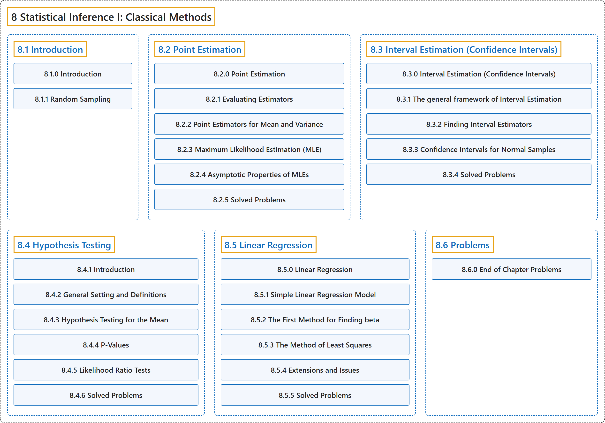

# 8 Statistical Inference I: Classical Methods

## Classification

## Glossary

| Term | Definition | 中文翻译 | Source |
|---|---|---|---|
| **8 Statistical Inference I: Classical Methods** 统计推断一：经典方法 | (No definition) | （无定义） | [Pishro-Nik, 2014, chapter 8](https://www.probabilitycourse.com/) |
| **[8.1 Introduction](8-1-introduction.md)** 介绍 | (No definition) | （无定义） | [Pishro-Nik, 2014, section 8.1](https://www.probabilitycourse.com/chapter8/8_1_0_intro.php) |
| **[8.2 Point Estimation](8-2-point-estimation.md)** 点估计 | (No definition) | （无定义） | [Pishro-Nik, 2014, section 8.2](https://www.probabilitycourse.com/chapter8/8_2_0_point_estimation.php) |
| **[8.3 Interval Estimation (Confidence Intervals)](8-3-interval-estimation-confidence-intervals.md)** 区间估计（置信区间） | (No definition) | （无定义） | [Pishro-Nik, 2014, section 8.3](https://www.probabilitycourse.com/chapter8/8_3_0_interval_estimation.php) |
| **[8.4 Hypothesis Testing](8-4-hypothesis-testing.md)** 假设检验 | (No definition) | （无定义） | [Pishro-Nik, 2014, section 8.4](https://www.probabilitycourse.com/chapter8/8_4_1_intro.php) |
| **[8.5 Linear Regression](8-5-linear-regression.md)** 线性回归 | (No definition) | （无定义） | [Pishro-Nik, 2014, section 8.5](https://www.probabilitycourse.com/chapter8/8_5_0_linear_regression.php) |
| **[8.6 Problems](8-6-problems.md)** 习题 | (No definition) | （无定义） | [Pishro-Nik, 2014, section 8.6](https://www.probabilitycourse.com/chapter8/8_6_0_ch_probs.php) |

## References

Pishro-Nik, H. (2014). *Introduction to probability, statistics, and random processes*. Kappa Research. Retrieved October 28, 2026, from <https://www.probabilitycourse.com/>
