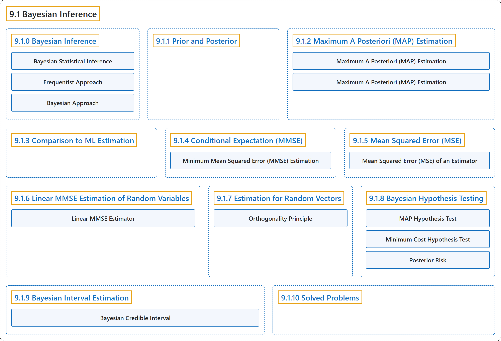

# 9.1 Bayesian Inference

## Classification

## Glossary

| Term | Definition | 中文翻译 | Source |
|---|---|---|---|
| **9.1 Bayesian Inference** 贝叶斯推断 | (No definition) | （无定义） | [Pishro-Nik, 2014, section 9.1](https://www.probabilitycourse.com/chapter9/9_1_0_bayesian_inference.php) |
| **9.1.0 Bayesian Inference** 贝叶斯推断 | (No definition) | （无定义） | [Pishro-Nik, 2014, section 9.1.0](https://www.probabilitycourse.com/chapter9/9_1_0_bayesian_inference.php) |
| **Bayesian Statistical Inference** 贝叶斯统计推断 | "The **posterior distribution** is usually found using **Bayes' formula**. Using the posterior distribution, we can then find point or interval estimates of $X$." | **后验分布**通常用**贝叶斯公式**求得。利用后验分布，我们就可以求出 $X$ 的点估计或区间估计。 | [Pishro-Nik, 2014, section 9.1.0](https://www.probabilitycourse.com/chapter9/9_1_0_bayesian_inference.php#:~:text=The%20posterior%20distribution%20is%20usually%20found) |
| **Frequentist Approach** 频率学派方法 | "In the previous chapter, we discussed the **frequentist approach** to this problem. In that approach, the unknown quantity $\theta$ is assumed to be a **fixed (non-random) quantity** that is to be estimated by the observed data." | 在上一章中，我们讨论了解决这一问题的**频率学派方法**。在该方法中，未知量 $\theta$ 被假定为一个**固定的（非随机的）量**，由观测数据对其进行估计。 | [Pishro-Nik, 2014, section 9.1.0](https://www.probabilitycourse.com/chapter9/9_1_0_bayesian_inference.php#:~:text=In%20the%20previous%20chapter%2C%20we%20discussed) |
| **Bayesian Approach** 贝叶斯方法 | "In the **Bayesian framework**, we treat the unknown quantity, $\Theta$, as a **random variable**. More specifically, we assume that we have some initial guess about the distribution of $\Theta$." | 在**贝叶斯框架**中，我们把未知量 $\Theta$ 视为一个**随机变量**。更具体地说，我们假定对 $\Theta$ 的分布有某种初始猜测。 | [Pishro-Nik, 2014, section 9.1.0](https://www.probabilitycourse.com/chapter9/9_1_0_bayesian_inference.php#:~:text=In%20the%20Bayesian%20framework%2C%20we%20treat) |
| **9.1.1 Prior and Posterior** 先验与后验 | (No definition) | （无定义） | [Pishro-Nik, 2014, section 9.1.1](https://www.probabilitycourse.com/chapter9/9_1_1_prior_and_posterior.php) |
| **9.1.2 Maximum A Posteriori (MAP) Estimation** 最大后验（MAP）估计 | (No definition) | （无定义） | [Pishro-Nik, 2014, section 9.1.2](https://www.probabilitycourse.com/chapter9/9_1_2_MAP_estimation.php) |
| **Maximum A Posteriori (MAP) Estimation** 最大后验概率估计 | "The **MAP estimate** of the random variable $X$, given that we have observed $Y=y$, is given by the value of $x$ that **maximizes**" | 在已观测到 $Y=y$ 的条件下，随机变量 $X$ 的**MAP 估计**由使下式**最大化**的 $x$ 值给出 | [Pishro-Nik, 2014, section 9.1.2](https://www.probabilitycourse.com/chapter9/9_1_2_MAP_estimation.php#:~:text=The%20MAP%20estimate%20of%20the%20random) |
| **Maximum A Posteriori (MAP) Estimation** 最大后验估计 | "To find the **MAP estimate** of $X$ given that we have observed $Y=y$, we find the value of $x$ that maximizes" | 要在已观测到 $Y=y$ 的条件下求 $X$ 的 **MAP 估计**，需找到使下式最大的 $x$ 值 | [Pishro-Nik, 2014, section 9.1.2](https://www.probabilitycourse.com/chapter9/9_1_2_MAP_estimation.php#:~:text=To%20find%20the%20MAP%20estimate%20of) |
| **9.1.3 Comparison to ML Estimation** 与最大似然估计的比较 | (No definition) | （无定义） | [Pishro-Nik, 2014, section 9.1.3](https://www.probabilitycourse.com/chapter9/9_1_3_comparison_to_ML_estimation.php) |
| **9.1.4 Conditional Expectation (MMSE)** 条件期望（MMSE） | (No definition) | （无定义） | [Pishro-Nik, 2014, section 9.1.4](https://www.probabilitycourse.com/chapter9/9_1_4_conditional_expectation_MMSE.php) |
| **Minimum Mean Squared Error (MMSE) Estimation** 最小均方误差估计 | "The **minimum mean squared error (MMSE) estimate** of the random variable $X$, given that we have observed $Y=y$, is given by $$\begin{align} \hat{x}_{M}=E[X\vert Y=y]. \end{align}$$" | 在已观测到 $Y=y$ 的条件下，随机变量 $X$ 的**最小均方误差（MMSE）估计**为 $$\begin{align} \hat{x}_{M}=E[X\vert Y=y]. \end{align}$$ | [Pishro-Nik, 2014, section 9.1.4](https://www.probabilitycourse.com/chapter9/9_1_4_conditional_expectation_MMSE.php#:~:text=The%20minimum%20mean%20squared%20error%20%28MMSE%29) |
| **9.1.5 Mean Squared Error (MSE)** 均方误差（MSE） | (No definition) | （无定义） | [Pishro-Nik, 2014, section 9.1.5](https://www.probabilitycourse.com/chapter9/9_1_5_mean_squared_error_MSE.php) |
| **Mean Squared Error (MSE) of an Estimator** 估计量的均方误差 | "Let $\hat{X}=g(Y)$ be an estimator of the random variable $X$, given that we have observed the random variable $Y$. The **mean squared error (MSE)** of this estimator is defined as $$\begin{align} E[(X-\hat{X})^2]=E[(X-g(Y))^2]. \end{align}$$" | 设 $\hat{X}=g(Y)$ 为在已观测到随机变量 $Y$ 的条件下对随机变量 $X$ 的一个估计量。该估计量的**均方误差**（MSE）定义为 $$\begin{align} E[(X-\hat{X})^2]=E[(X-g(Y))^2]. \end{align}$$ | [Pishro-Nik, 2014, section 9.1.5](https://www.probabilitycourse.com/chapter9/9_1_5_mean_squared_error_MSE.php#:~:text=Let%20be%20an%20estimator%20of%20the) |
| **9.1.6 Linear MMSE Estimation of Random Variables** 随机变量的线性最小均方误差估计 | (No definition) | （无定义） | [Pishro-Nik, 2014, section 9.1.6](https://www.probabilitycourse.com/chapter9/9_1_6_linear_MMSE_estimat_of_random_vars.php) |
| **Linear MMSE Estimator** 线性最小均方误差估计量 | "The **linear MMSE estimator** of the random variable $X$, given that we have observed $Y$, is given by $$\begin{align} \hat{X}_L&=\frac{\textrm{Cov}(X,Y)}{\textrm{Var}(Y)} (Y-EY)+ EX\\ &=\frac{\rho \sigma_X}{\sigma_Y} (Y-EY)+ EX. \end{align}$$" | 在已观测到 $Y$ 的条件下，随机变量 $X$ 的**线性 MMSE 估计量**为 $$\begin{align} \hat{X}_L&=\frac{\textrm{Cov}(X,Y)}{\textrm{Var}(Y)} (Y-EY)+ EX\\ &=\frac{\rho \sigma_X}{\sigma_Y} (Y-EY)+ EX. \end{align}$$ | [Pishro-Nik, 2014, section 9.1.6](https://www.probabilitycourse.com/chapter9/9_1_6_linear_MMSE_estimat_of_random_vars.php#:~:text=The%20linear%20MMSE%20estimator%20of%20the) |
| **9.1.7 Estimation for Random Vectors** 随机向量的估计 | (No definition) | （无定义） | [Pishro-Nik, 2014, section 9.1.7](https://www.probabilitycourse.com/chapter9/9_1_7_estimation_for_random_vectors.php) |
| **Orthogonality Principle** 正交性原理 | "However, it is sometimes easier to use the **orthogonality principle** to find $\hat{\mathbf{X}}_L$. We now explain how to use the orthogonality principle to find **linear MMSE estimators**." | 然而，利用**正交性原理**来求 $\hat{\mathbf{X}}_L$ 有时更为简便。下面我们说明如何用正交性原理求**线性 MMSE 估计量**。 | [Pishro-Nik, 2014, section 9.1.7](https://www.probabilitycourse.com/chapter9/9_1_7_estimation_for_random_vectors.php#:~:text=However%2C%20it%20is%20sometimes%20easier%20to) |
| **9.1.8 Bayesian Hypothesis Testing** 贝叶斯假设检验 | (No definition) | （无定义） | [Pishro-Nik, 2014, section 9.1.8](https://www.probabilitycourse.com/chapter9/9_1_8_bayesian_hypothesis_testing.php) |
| **MAP Hypothesis Test** 最大后验概率假设检验 | "Choose the hypothesis with the **highest posterior probability**, $P(H_i\vert Y=y)$. Equivalently, choose hypothesis $H_i$ with the highest $f_{Y}(y\vert H_i)P(H_i)$." | 选择具有**最高后验概率** $P(H_i\vert Y=y)$ 的假设。等价地，选择假设 $H_i$，使 $f_{Y}(y\vert H_i)P(H_i)$ 最大。 | [Pishro-Nik, 2014, section 9.1.8](https://www.probabilitycourse.com/chapter9/9_1_8_bayesian_hypothesis_testing.php#:~:text=Choose%20the%20hypothesis%20with%20the%20highest) |
| **Minimum Cost Hypothesis Test** 最小代价假设检验 | "We choose $H_0$ **if and only if** $$\begin{align} \frac{f_{Y}(y\vert H_0)}{f_{Y}(y\vert H_1)} \geq \frac{P(H_1)C_{01}}{P(H_0) C_{10}}. \end{align}$$ Equivalently, we choose $H_0$ if and only if $$\begin{align} P(H_0\vert y) C_{10} \geq P(H_1\vert y) C_{01}. \end{align}$$" | 我们选择 $H_0$ **当且仅当** $$\begin{align} \frac{f_{Y}(y\vert H_0)}{f_{Y}(y\vert H_1)} \geq \frac{P(H_1)C_{01}}{P(H_0) C_{10}}. \end{align}$$ 等价地，我们选择 $H_0$ 当且仅当 $$\begin{align} P(H_0\vert y) C_{10} \geq P(H_1\vert y) C_{01}. \end{align}$$ | [Pishro-Nik, 2014, section 9.1.8](https://www.probabilitycourse.com/chapter9/9_1_8_bayesian_hypothesis_testing.php#:~:text=We%20choose%20if%20and%20only%20if) |
| **Posterior Risk** 后验风险 | "Note that $P(H_0\vert y) C_{10}$ is the **expected cost** of accepting $H_1$. We call this the **posterior risk** of accepting $H_1$." | 注意，$P(H_0\vert y) C_{10}$ 是接受 $H_1$ 的**期望代价**。我们称之为接受 $H_1$ 的**后验风险**。 | [Pishro-Nik, 2014, section 9.1.8](https://www.probabilitycourse.com/chapter9/9_1_8_bayesian_hypothesis_testing.php#:~:text=Note%20that%20is%20the%20expected%20cost) |
| **9.1.9 Bayesian Interval Estimation** 贝叶斯区间估计 | (No definition) | （无定义） | [Pishro-Nik, 2014, section 9.1.9](https://www.probabilitycourse.com/chapter9/9_1_9_bayesian_interval_estimation.php) |
| **Bayesian Credible Interval** 贝叶斯可信区间 | "Given the observation $Y=y$, the interval $[a,b]$ is said to be a $(1-\alpha)100\%$ **credible interval** for $X$, if the **posterior probability** of $X$ being in $[a,b]$ is equal to $1-\alpha$." | 给定观测 $Y=y$，若 $X$ 落在 $[a,b]$ 内的**后验概率**等于 $1-\alpha$，则称区间 $[a,b]$ 为 $X$ 的 $(1-\alpha)100\%$ **可信区间**。 | [Pishro-Nik, 2014, section 9.1.9](https://www.probabilitycourse.com/chapter9/9_1_9_bayesian_interval_estimation.php#:~:text=Given%20the%20observation%20%2C%20the%20interval) |
| **9.1.10 Solved Problems** 例题详解 | (No definition) | （无定义） | [Pishro-Nik, 2014, section 9.1.10](https://www.probabilitycourse.com/chapter9/9_1_10_solved_probs.php) |

## References

Pishro-Nik, H. (2014). *Introduction to probability, statistics, and random processes*. Kappa Research. Retrieved October 28, 2026, from <https://www.probabilitycourse.com/>
