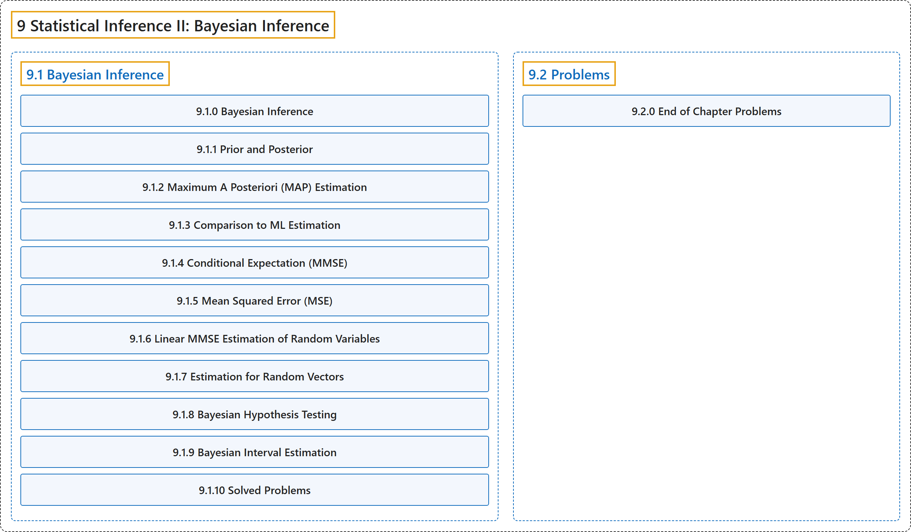

# 9 Statistical Inference II: Bayesian Inference

## Classification

## Glossary

| Term | Definition | 中文翻译 | Source |
|---|---|---|---|
| **9 Statistical Inference II: Bayesian Inference** 统计推断二：贝叶斯推断 | (No definition) | （无定义） | [Pishro-Nik, 2014, chapter 9](https://www.probabilitycourse.com/) |
| **[9.1 Bayesian Inference](9-1-bayesian-inference.md)** 贝叶斯推断 | (No definition) | （无定义） | [Pishro-Nik, 2014, section 9.1](https://www.probabilitycourse.com/chapter9/9_1_0_bayesian_inference.php) |
| **[9.2 Problems](9-2-problems.md)** 习题 | (No definition) | （无定义） | [Pishro-Nik, 2014, section 9.2](https://www.probabilitycourse.com/chapter9/9_2_0_ch_probs.php) |

## References

Pishro-Nik, H. (2014). *Introduction to probability, statistics, and random processes*. Kappa Research. Retrieved October 28, 2026, from <https://www.probabilitycourse.com/>
