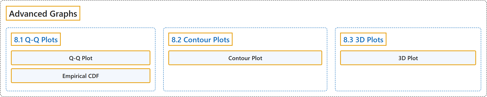

# 8 Advanced Graphs

## Classification

## Glossary

| Term | Definition | 中文翻译 | Source |
|---|---|---|---|
| **8 Advanced Graphs** 高级图形 | (No definition) | （无定义） | [Online Statistics Education, n.d., chapter 8](https://onlinestatbook.com/2/advanced_graphs/contents.html) |
| **8.1 Q-Q Plots** Q-Q 图 | (No definition) | （无定义） | [Online Statistics Education, n.d., section 8.1](https://onlinestatbook.com/2/advanced_graphs/q-q_plots.html) |
| **Q-Q Plot** Q-Q 图 | "The quantile-quantile or **q-q plot** is an **exploratory graphical device** used to check the validity of a distributional assumption for a data set." | 分位数-分位数图即 **Q-Q 图**，是一种**探索性图形工具**，用于检验某个数据集的分布假设是否成立。 | [Online Statistics Education, n.d., section 8.1](https://onlinestatbook.com/2/advanced_graphs/q-q_plots.html) |
| **Empirical CDF** 经验累积分布函数 | "The CDF based upon the sample data is called the **empirical CDF** (ECDF), is denoted by …, and is defined to be the **fraction of the data less than or equal to** $\mu$" | 基于样本数据的 CDF 称为**经验累积分布函数**（ECDF），记作 …，定义为数据中**小于或等于** $\mu$ 的那部分所占的比例 | [Online Statistics Education, n.d., section 8.1](https://onlinestatbook.com/2/advanced_graphs/q-q_plots.html) |
| **8.2 Contour Plots** 等高线图 | (No definition) | （无定义） | [Online Statistics Education, n.d., section 8.2](https://onlinestatbook.com/2/advanced_graphs/contour.html) |
| **Contour Plot** 等高线图 | "**Contour plots** portray data for **three variables in two dimensions**." | **等高线图**在**二维平面上描绘三个变量**的数据。 | [Online Statistics Education, n.d., section 8.2](https://onlinestatbook.com/2/advanced_graphs/contour.html) |
| **8.3 3D Plots** 三维图 | (No definition) | （无定义） | [Online Statistics Education, n.d., section 8.3](https://onlinestatbook.com/2/advanced_graphs/3D.html) |
| **3D Plot** 三维图 | "Just as two-dimensional scatter plots show the data in two dimensions, **3D plots** show data in **three dimensions**." | 正如二维散点图在二维中展示数据一样，**三维图**在**三维**中展示数据。 | [Online Statistics Education, n.d., section 8.3](https://onlinestatbook.com/2/advanced_graphs/3D.html) |

## References

*Online statistics education: An interactive multimedia course of study*. (n.d.). Rice University, University of Houston Clear Lake, and Tufts University. Retrieved October 29, 2026, from <https://onlinestatbook.com/2/>
