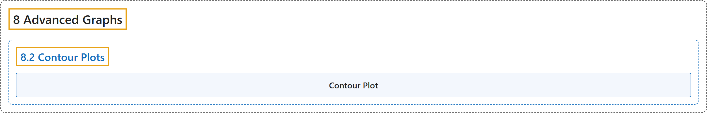

# 8.2 Contour Plots

## Classification

## Glossary

| Term | Definition | 中文翻译 | Source |
|---|---|---|---|
| **8.2 Contour Plots** 等高线图 | (No definition) | （无定义） | [Online Statistics Education, n.d., section 8.2](https://onlinestatbook.com/2/advanced_graphs/contour.html) |
| **Contour Plot** 等高线图 | "**Contour plots** portray data for **three variables in two dimensions**." | **等高线图**在**二维平面上描绘三个变量**的数据。 | [Online Statistics Education, n.d., section 8.2](https://onlinestatbook.com/2/advanced_graphs/contour.html) |

## References

*Online statistics education: An interactive multimedia course of study*. (n.d.). Rice University, University of Houston Clear Lake, and Tufts University. Retrieved October 29, 2026, from <https://onlinestatbook.com/2/>
