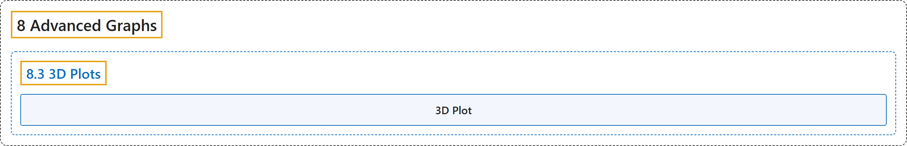

# 8.3 3D Plots

## Classification

## Glossary

| Term | Definition | 中文翻译 | Source |
|---|---|---|---|
| **8.3 3D Plots** 三维图 | (No definition) | （无定义） | [Online Statistics Education, n.d., section 8.3](https://onlinestatbook.com/2/advanced_graphs/3D.html) |
| **3D Plot** 三维图 | "Just as two-dimensional scatter plots show the data in two dimensions, **3D plots** show data in **three dimensions**." | 正如二维散点图在二维中展示数据一样，**三维图**在**三维**中展示数据。 | [Online Statistics Education, n.d., section 8.3](https://onlinestatbook.com/2/advanced_graphs/3D.html) |

## References

*Online statistics education: An interactive multimedia course of study*. (n.d.). Rice University, University of Houston Clear Lake, and Tufts University. Retrieved October 29, 2026, from <https://onlinestatbook.com/2/>
