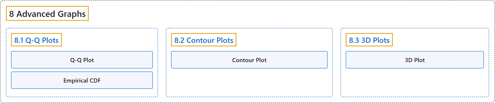

# 8 Advanced Graphs

## Classification

## Glossary

| Term | Definition | 中文翻译 | Source |
|---|---|---|---|
| **8 Advanced Graphs** 高级图形 | (No definition) | （无定义） | [Online Statistics Education, n.d., chapter 8](https://onlinestatbook.com/2/advanced_graphs/contents.html) |
| **[8.1 Q-Q Plots](8-1-q-q-plots.md)** Q-Q 图 | (No definition) | （无定义） | [Online Statistics Education, n.d., section 8.1](https://onlinestatbook.com/2/advanced_graphs/q-q_plots.html) |
| **[8.2 Contour Plots](8-2-contour-plots.md)** 等高线图 | (No definition) | （无定义） | [Online Statistics Education, n.d., section 8.2](https://onlinestatbook.com/2/advanced_graphs/contour.html) |
| **[8.3 3D Plots](8-3-3d-plots.md)** 三维图 | (No definition) | （无定义） | [Online Statistics Education, n.d., section 8.3](https://onlinestatbook.com/2/advanced_graphs/3D.html) |

## References

*Online statistics education: An interactive multimedia course of study*. (n.d.). Rice University, University of Houston Clear Lake, and Tufts University. Retrieved October 29, 2026, from <https://onlinestatbook.com/2/>
