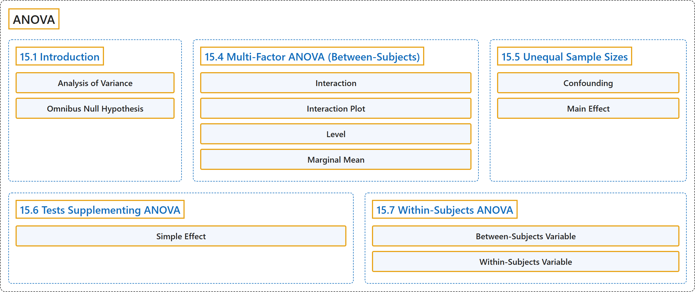

# 15 ANOVA

## Classification

## Glossary

| Term | Definition | 中文翻译 | Source |
|---|---|---|---|
| **15 ANOVA** 方差分析 | (No definition) | （无定义） | [Online Statistics Education, n.d., chapter 15](https://onlinestatbook.com/2/analysis_of_variance/ANOVA.html) |
| **15.1 Introduction** 引言 | (No definition) | （无定义） | [Online Statistics Education, n.d., section 15.1](https://onlinestatbook.com/2/analysis_of_variance/intro.html) |
| **Analysis of Variance** 方差分析 | "**Analysis of variance** is a method for testing hypotheses about means. It is the most widely-used method of statistical inference for the analysis of experimental data." | **方差分析**是检验关于均值的假设的一种方法。它是用于分析实验数据的应用最广泛的统计推断方法。 | [Online Statistics Education, n.d., glossary](https://onlinestatbook.com/2/glossary/anova.html) |
| **Omnibus Null Hypothesis** 总括零假设 | "The **null hypothesis that all population means are equal**." | **所有总体均值都相等的零假设**。 | [Online Statistics Education, n.d., glossary](https://onlinestatbook.com/2/glossary/omnibus.html) |
| **15.4 Multi-Factor ANOVA (Between-Subjects)** 多因素方差分析（组间） | (No definition) | （无定义） | [Online Statistics Education, n.d., section 15.4](https://onlinestatbook.com/2/analysis_of_variance/multiway.html) |
| **Interaction** 交互作用 | "Two independent variables **interact** if the effect of one of the variables differs depending on the level of the other variable. See also: interaction plot" | 如果一个变量的效应因另一个变量的水平而不同，则这两个自变量存在**交互作用**。另见：交互作用图 | [Online Statistics Education, n.d., glossary](https://onlinestatbook.com/2/glossary/interaction.html) |
| **Interaction Plot** 交互作用图 | "An **interaction plot** displays the levels of one variable on the $X$ axis and has a separate line for the means of each level of the other variable. The $Y$ axis is the dependent variable. A look at this graph shows that the effect of dosage is different for males than it is for females. See also: interaction." | **交互作用图**在 $X$ 轴上显示一个变量的各水平，并为另一个变量每个水平的均值绘制单独的一条线。$Y$ 轴为因变量。观察该图可知，剂量的效应对男性和对女性是不同的。另见：交互作用。 | [Online Statistics Education, n.d., glossary](https://onlinestatbook.com/2/glossary/interaction_plot.html) |
| **Level** 水平 | "When a factor consists of various treatment conditions, each treatment condition is considered a **level** of that factor. For example, if the factor were drug dosage, and three doses were tested, then each dosage would be one level of the factor and the factor would have three levels." | 当一个因素由多种处理条件构成时，每种处理条件被视为该因素的一个**水平**。例如，若因素为药物剂量，并测试了三种剂量，则每种剂量就是该因素的一个水平，该因素就有三个水平。 | [Online Statistics Education, n.d., glossary](https://onlinestatbook.com/2/glossary/level.html) |
| **Marginal Mean** 边缘均值 | "In a design with two factors, the **marginal means** for one factor are **the means for that factor averaged across all levels of the other factor**. In the table shown below, the two factors are "Relationship" and "Companion Weight." The marginal means for each of the two levels of Relationship (Girl Friend and Acquaintance) are computed by averaging across the two levels of Companion Weight. Thus, the marginal mean for Acquaintance of 6.37 is the mean of 6.15 and 6.59." | 在有两个因素的设计中，一个因素的**边缘均值**是**该因素在对另一个因素的所有水平取平均后的均值**。在下表中，两个因素是“Relationship”和“Companion Weight”。关系（Girl Friend 和 Acquaintance）两个水平各自的边缘均值，是通过对同伴体重的两个水平取平均计算得出的。因此，Acquaintance 的边缘均值 6.37 是 6.15 和 6.59 的均值。 | [Online Statistics Education, n.d., glossary](https://onlinestatbook.com/2/glossary/marginal_mean.html) |
| **15.5 Unequal Sample Sizes** 不等样本量 | (No definition) | （无定义） | [Online Statistics Education, n.d., section 15.5](https://onlinestatbook.com/2/analysis_of_variance/unequal.html) |
| **Confounding** 混淆 | "Two or more variables are **confounded** if **their effects cannot be separated because they vary together**. For example, if a study on the effect of light inadvertently manipulated heat along with light, then light and heat would be confounded. See: third variable problem." | 如果两个或多个变量因同时变化而**无法区分各自的效应**，则称它们是**混淆**的。例如，如果一项关于光照效应的研究在操纵光照的同时无意中也操纵了热量，那么光照与热量就是混淆的。参见：第三变量问题。 | [Online Statistics Education, n.d., glossary](https://onlinestatbook.com/2/glossary/confounds.html) |
| **Main Effect** 主效应 | "A **main effect** of an independent variable is **the effect of the variable averaging over all levels of the other variable(s)**. For example, in a design with age and gender as factors, the main effect of gender would be the difference between the genders averaging across all ages used in the experiment. See also simple effect." | 一个自变量的**主效应**是**该变量在对其他变量的所有水平取平均后的效应**。例如，在以年龄和性别为因素的设计中，性别的主效应是对实验中使用的所有年龄取平均后两种性别之间的差异。另见简单效应。 | [Online Statistics Education, n.d., glossary](https://onlinestatbook.com/2/glossary/main_effect.html) |
| **15.6 Tests Supplementing ANOVA** 方差分析的补充检验 | (No definition) | （无定义） | [Online Statistics Education, n.d., section 15.6](https://onlinestatbook.com/2/analysis_of_variance/tests_supplementing.html) |
| **Simple Effect** 简单效应 | "The **simple effect** of a factor is the **effect of that factor at a single level of another factor**. For example, in a design with age and gender as factors, the effect of age for females would be one of the simple effects of age." | 一个因素的**简单效应**是**该因素在另一因素的单一水平上的效应**。例如，在以年龄和性别为因素的设计中，女性的年龄效应就是年龄的简单效应之一。 | [Online Statistics Education, n.d., glossary](https://onlinestatbook.com/2/glossary/simple_effect.html) |
| **15.7 Within-Subjects ANOVA** 组内方差分析 | (No definition) | （无定义） | [Online Statistics Education, n.d., section 15.7](https://onlinestatbook.com/2/analysis_of_variance/within-subjects.html) |
| **Between-Subjects Variable** 被试间变量 | "**Between-subject variables** are independent variables or factors in which **a different group of subjects is used for each level of the variable**. If an experiment is conducted comparing four methods of teaching vocabulary and if a different group of subjects is used for each of the four teaching methods, then teaching method is a between-subjects variable." | **被试间变量**是自变量或因素，其**每个水平使用不同的被试组**。如果进行一项比较四种词汇教学方法的实验，并且四种教学方法各使用不同的被试组，那么教学方法就是被试间变量。 | [Online Statistics Education, n.d., glossary](https://onlinestatbook.com/2/glossary/between-subjects.html) |
| **Within-Subjects Variable** 被试内变量 | "A **within-subjects variable** is an independent variable that is **manipulated by testing each subject at each level of the variable**. Compare with a between-subjects variable in which different groups of subjects are used for each level of the variable." | **被试内变量**是**通过在变量的每个水平上测试每个被试来操纵**的自变量。与被试间变量相对照，后者的每个水平使用不同的被试组。 | [Online Statistics Education, n.d., glossary](https://onlinestatbook.com/2/glossary/within-subjects.html) |

## References

*Online statistics education: An interactive multimedia course of study*. (n.d.). Rice University, University of Houston Clear Lake, and Tufts University. Retrieved October 29, 2026, from <https://onlinestatbook.com/2/>
