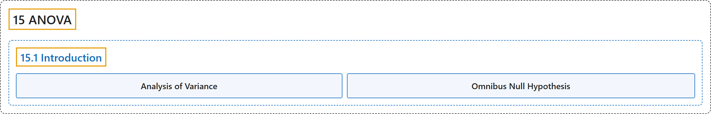

# 15.1 Introduction

## Classification

## Glossary

| Term | Definition | 中文翻译 | Source |
|---|---|---|---|
| **15.1 Introduction** 介绍 | (No definition) | （无定义） | [Online Statistics Education, n.d., section 15.1](https://onlinestatbook.com/2/analysis_of_variance/intro.html) |
| **Analysis of Variance** 方差分析 | "**Analysis of variance** is a method for testing hypotheses about means. It is the most widely-used method of statistical inference for the analysis of experimental data." | **方差分析**是检验关于均值的假设的一种方法。它是用于分析实验数据的应用最广泛的统计推断方法。 | [Online Statistics Education, n.d., glossary](https://onlinestatbook.com/2/glossary/anova.html) |
| **Omnibus Null Hypothesis** 总括零假设 | "The **null hypothesis that all population means are equal**." | **所有总体均值都相等的零假设**。 | [Online Statistics Education, n.d., glossary](https://onlinestatbook.com/2/glossary/omnibus.html) |

## References

*Online statistics education: An interactive multimedia course of study*. (n.d.). Rice University, University of Houston Clear Lake, and Tufts University. Retrieved October 29, 2026, from <https://onlinestatbook.com/2/>
