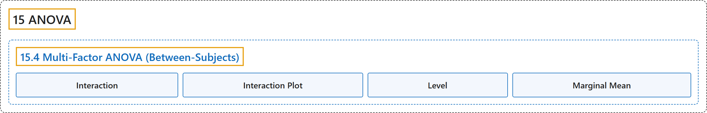

# 15.4 Multi-Factor ANOVA (Between-Subjects)

## Classification

## Glossary

| Term | Definition | 中文翻译 | Source |
|---|---|---|---|
| **15.4 Multi-Factor ANOVA (Between-Subjects)** 多因素方差分析（组间） | (No definition) | （无定义） | [Online Statistics Education, n.d., section 15.4](https://onlinestatbook.com/2/analysis_of_variance/multiway.html) |
| **Interaction** 交互作用 | "Two independent variables **interact** if the effect of one of the variables differs depending on the level of the other variable. See also: interaction plot" | 如果一个变量的效应因另一个变量的水平而不同，则这两个自变量存在**交互作用**。另见：交互作用图 | [Online Statistics Education, n.d., glossary](https://onlinestatbook.com/2/glossary/interaction.html) |
| **Interaction Plot** 交互作用图 | "An **interaction plot** displays the levels of one variable on the $X$ axis and has a separate line for the means of each level of the other variable. The $Y$ axis is the dependent variable. A look at this graph shows that the effect of dosage is different for males than it is for females. See also: interaction." | **交互作用图**在 $X$ 轴上显示一个变量的各水平，并为另一个变量每个水平的均值绘制单独的一条线。$Y$ 轴为因变量。观察该图可知，剂量的效应对男性和对女性是不同的。另见：交互作用。 | [Online Statistics Education, n.d., glossary](https://onlinestatbook.com/2/glossary/interaction_plot.html) |
| **Level** 水平 | "When a factor consists of various treatment conditions, each treatment condition is considered a **level** of that factor. For example, if the factor were drug dosage, and three doses were tested, then each dosage would be one level of the factor and the factor would have three levels." | 当一个因素由多种处理条件构成时，每种处理条件被视为该因素的一个**水平**。例如，若因素为药物剂量，并测试了三种剂量，则每种剂量就是该因素的一个水平，该因素就有三个水平。 | [Online Statistics Education, n.d., glossary](https://onlinestatbook.com/2/glossary/level.html) |
| **Marginal Mean** 边缘均值 | "In a design with two factors, the **marginal means** for one factor are **the means for that factor averaged across all levels of the other factor**. In the table shown below, the two factors are "Relationship" and "Companion Weight." The marginal means for each of the two levels of Relationship (Girl Friend and Acquaintance) are computed by averaging across the two levels of Companion Weight. Thus, the marginal mean for Acquaintance of 6.37 is the mean of 6.15 and 6.59." | 在有两个因素的设计中，一个因素的**边缘均值**是**该因素在对另一个因素的所有水平取平均后的均值**。在下表中，两个因素是“Relationship”和“Companion Weight”。关系（Girl Friend 和 Acquaintance）两个水平各自的边缘均值，是通过对同伴体重的两个水平取平均计算得出的。因此，Acquaintance 的边缘均值 6.37 是 6.15 和 6.59 的均值。 | [Online Statistics Education, n.d., glossary](https://onlinestatbook.com/2/glossary/marginal_mean.html) |

## References

*Online statistics education: An interactive multimedia course of study*. (n.d.). Rice University, University of Houston Clear Lake, and Tufts University. Retrieved October 29, 2026, from <https://onlinestatbook.com/2/>
