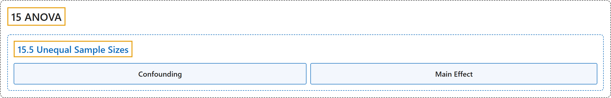

# 15.5 Unequal Sample Sizes

## Classification

## Glossary

| Term | Definition | 中文翻译 | Source |
|---|---|---|---|
| **15.5 Unequal Sample Sizes** 不等样本量 | (No definition) | （无定义） | [Online Statistics Education, n.d., section 15.5](https://onlinestatbook.com/2/analysis_of_variance/unequal.html) |
| **Confounding** 混淆 | "Two or more variables are **confounded** if **their effects cannot be separated because they vary together**. For example, if a study on the effect of light inadvertently manipulated heat along with light, then light and heat would be confounded. See: third variable problem." | 如果两个或多个变量因同时变化而**无法区分各自的效应**，则称它们是**混淆**的。例如，如果一项关于光照效应的研究在操纵光照的同时无意中也操纵了热量，那么光照与热量就是混淆的。参见：第三变量问题。 | [Online Statistics Education, n.d., glossary](https://onlinestatbook.com/2/glossary/confounds.html) |
| **Main Effect** 主效应 | "A **main effect** of an independent variable is **the effect of the variable averaging over all levels of the other variable(s)**. For example, in a design with age and gender as factors, the main effect of gender would be the difference between the genders averaging across all ages used in the experiment. See also simple effect." | 一个自变量的**主效应**是**该变量在对其他变量的所有水平取平均后的效应**。例如，在以年龄和性别为因素的设计中，性别的主效应是对实验中使用的所有年龄取平均后两种性别之间的差异。另见简单效应。 | [Online Statistics Education, n.d., glossary](https://onlinestatbook.com/2/glossary/main_effect.html) |

## References

*Online statistics education: An interactive multimedia course of study*. (n.d.). Rice University, University of Houston Clear Lake, and Tufts University. Retrieved October 29, 2026, from <https://onlinestatbook.com/2/>
