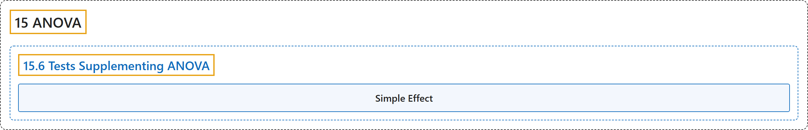

# 15.6 Tests Supplementing ANOVA

## Classification

## Glossary

| Term | Definition | 中文翻译 | Source |
|---|---|---|---|
| **15.6 Tests Supplementing ANOVA** 方差分析的补充检验 | (No definition) | （无定义） | [Online Statistics Education, n.d., section 15.6](https://onlinestatbook.com/2/analysis_of_variance/tests_supplementing.html) |
| **Simple Effect** 简单效应 | "The **simple effect** of a factor is the **effect of that factor at a single level of another factor**. For example, in a design with age and gender as factors, the effect of age for females would be one of the simple effects of age." | 一个因素的**简单效应**是**该因素在另一因素的单一水平上的效应**。例如，在以年龄和性别为因素的设计中，女性的年龄效应就是年龄的简单效应之一。 | [Online Statistics Education, n.d., glossary](https://onlinestatbook.com/2/glossary/simple_effect.html) |

## References

*Online statistics education: An interactive multimedia course of study*. (n.d.). Rice University, University of Houston Clear Lake, and Tufts University. Retrieved October 29, 2026, from <https://onlinestatbook.com/2/>
