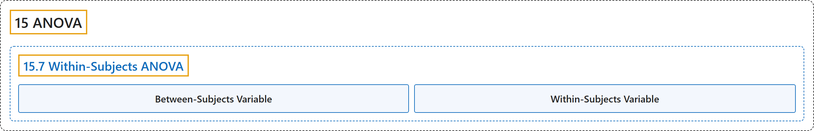

# 15.7 Within-Subjects ANOVA

## Classification

## Glossary

| Term | Definition | 中文翻译 | Source |
|---|---|---|---|
| **15.7 Within-Subjects ANOVA** 组内方差分析 | (No definition) | （无定义） | [Online Statistics Education, n.d., section 15.7](https://onlinestatbook.com/2/analysis_of_variance/within-subjects.html) |
| **Between-Subjects Variable** 被试间变量 | "**Between-subject variables** are independent variables or factors in which **a different group of subjects is used for each level of the variable**. If an experiment is conducted comparing four methods of teaching vocabulary and if a different group of subjects is used for each of the four teaching methods, then teaching method is a between-subjects variable." | **被试间变量**是自变量或因素，其**每个水平使用不同的被试组**。如果进行一项比较四种词汇教学方法的实验，并且四种教学方法各使用不同的被试组，那么教学方法就是被试间变量。 | [Online Statistics Education, n.d., glossary](https://onlinestatbook.com/2/glossary/between-subjects.html) |
| **Within-Subjects Variable** 被试内变量 | "A **within-subjects variable** is an independent variable that is **manipulated by testing each subject at each level of the variable**. Compare with a between-subjects variable in which different groups of subjects are used for each level of the variable." | **被试内变量**是**通过在变量的每个水平上测试每个被试来操纵**的自变量。与被试间变量相对照，后者的每个水平使用不同的被试组。 | [Online Statistics Education, n.d., glossary](https://onlinestatbook.com/2/glossary/within-subjects.html) |

## References

*Online statistics education: An interactive multimedia course of study*. (n.d.). Rice University, University of Houston Clear Lake, and Tufts University. Retrieved October 29, 2026, from <https://onlinestatbook.com/2/>
