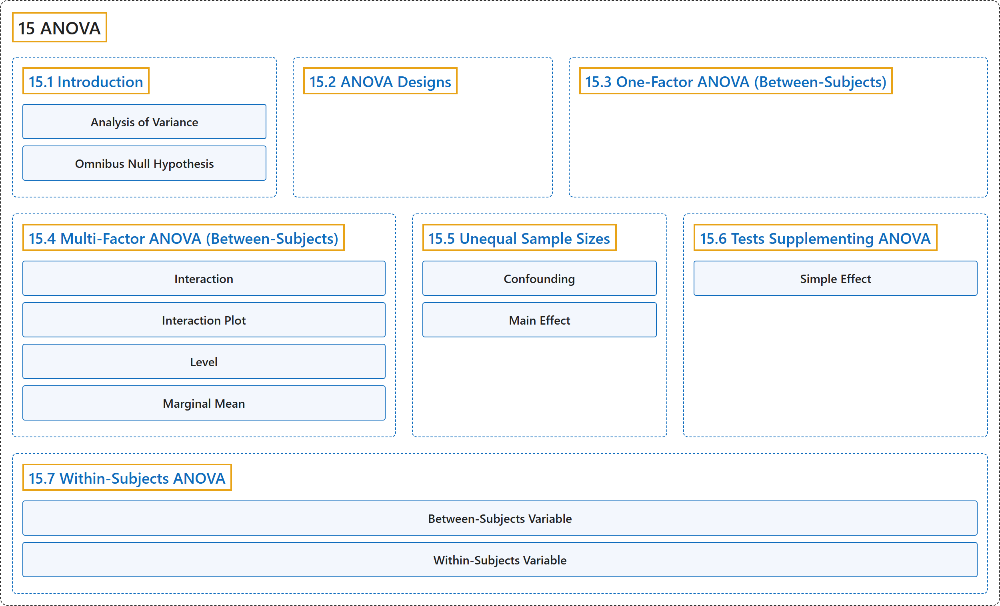

# 15 ANOVA

## Classification

## Glossary

| Term | Definition | 中文翻译 | Source |
|---|---|---|---|
| **15 ANOVA** 方差分析 | (No definition) | （无定义） | [Online Statistics Education, n.d., chapter 15](https://onlinestatbook.com/2/analysis_of_variance/ANOVA.html) |
| **[15.1 Introduction](15-1-introduction.md)** 介绍 | (No definition) | （无定义） | [Online Statistics Education, n.d., section 15.1](https://onlinestatbook.com/2/analysis_of_variance/intro.html) |
| **[15.2 ANOVA Designs](15-2-anova-designs.md)** 方差分析设计 | (No definition) | （无定义） | [Online Statistics Education, n.d., section 15.2](https://onlinestatbook.com/2/analysis_of_variance/anova_designs.html) |
| **[15.3 One-Factor ANOVA (Between-Subjects)](15-3-one-factor-anova-between-subjects.md)** 单因素方差分析（被试间） | (No definition) | （无定义） | [Online Statistics Education, n.d., section 15.3](https://onlinestatbook.com/2/analysis_of_variance/one-way.html) |
| **[15.4 Multi-Factor ANOVA (Between-Subjects)](15-4-multi-factor-anova-between-subjects.md)** 多因素方差分析（组间） | (No definition) | （无定义） | [Online Statistics Education, n.d., section 15.4](https://onlinestatbook.com/2/analysis_of_variance/multiway.html) |
| **[15.5 Unequal Sample Sizes](15-5-unequal-sample-sizes.md)** 不等样本量 | (No definition) | （无定义） | [Online Statistics Education, n.d., section 15.5](https://onlinestatbook.com/2/analysis_of_variance/unequal.html) |
| **[15.6 Tests Supplementing ANOVA](15-6-tests-supplementing-anova.md)** 方差分析的补充检验 | (No definition) | （无定义） | [Online Statistics Education, n.d., section 15.6](https://onlinestatbook.com/2/analysis_of_variance/tests_supplementing.html) |
| **[15.7 Within-Subjects ANOVA](15-7-within-subjects-anova.md)** 组内方差分析 | (No definition) | （无定义） | [Online Statistics Education, n.d., section 15.7](https://onlinestatbook.com/2/analysis_of_variance/within-subjects.html) |

## References

*Online statistics education: An interactive multimedia course of study*. (n.d.). Rice University, University of Houston Clear Lake, and Tufts University. Retrieved October 29, 2026, from <https://onlinestatbook.com/2/>
