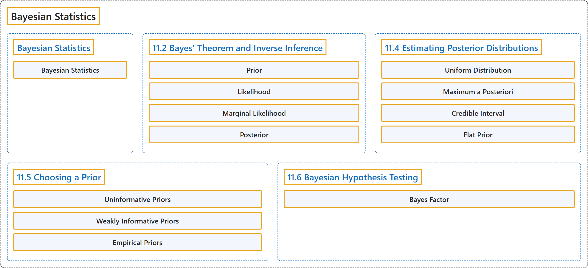

# 23 Bayesian Statistics

## Classification

## Glossary

| Term | Definition | 中文翻译 | Source |
|---|---|---|---|
| **23 Bayesian Statistics** 贝叶斯统计 | (No definition) | （无定义） | [Poldrack, 2023, chapter 11](https://statsthinking21.github.io/statsthinking21-core-site/bayesian-statistics.html) |
| **Bayesian Statistics** 贝叶斯统计 | "In this chapter we will take up **the approach to statistical modeling and inference** that stands in contrast to the null hypothesis testing framework that you encountered in Chapter 9." | 在本章中，我们将讨论与你在第9章中遇到的零假设检验框架相对立的**统计建模与推断方法**。 | [Poldrack, 2023, section 11](https://statsthinking21.github.io/statsthinking21-core-site/bayesian-statistics.html) |
| **11.2 Bayes' Theorem and Inverse Inference** 贝叶斯定理与逆推断 | (No definition) | （无定义） | [Poldrack, 2023, section 11.2](https://statsthinking21.github.io/statsthinking21-core-site/bayesian-statistics.html#bayes-theorem-and-inverse-inference) |
| **Prior** 先验 | "**prior** ($P(\text{Hypothesis})$): Our **degree of belief** about hypothesis $H$ before seeing the data $D$" | **先验**（$P(\text{Hypothesis})$）：在看到数据 $D$ 之前，我们对假设 $H$ 的**信念程度** | [Poldrack, 2023, section 11.2](https://statsthinking21.github.io/statsthinking21-core-site/bayesian-statistics.html) |
| **Likelihood** 似然 | "**likelihood** ($P(\text{Data} \vert \text{Hypothesis})$): **How likely are the observed data** $D$ under hypothesis $H$?" | **似然**（$P(\text{Data} \vert \text{Hypothesis})$）：在假设 $H$ 下，观测到数据 $D$ 的**可能性有多大**？ | [Poldrack, 2023, section 11.2](https://statsthinking21.github.io/statsthinking21-core-site/bayesian-statistics.html) |
| **Marginal Likelihood** 边际似然 | "**marginal likelihood** ($P(\text{Data})$): **How likely are the observed data**, combining over all possible hypotheses?" | **边际似然**（$P(\text{Data})$）：综合所有可能的假设，观测到数据的**可能性有多大**？ | [Poldrack, 2023, section 11.2](https://statsthinking21.github.io/statsthinking21-core-site/bayesian-statistics.html) |
| **Posterior** 后验 | "**posterior** ($P(\text{Hypothesis} \vert \text{Data})$): Our **updated belief** about hypothesis $H$, given the data $D$" | **后验**（$P(\text{Hypothesis} \vert \text{Data})$）：给定数据 $D$，我们对假设 $H$ 的**更新后的信念** | [Poldrack, 2023, section 11.2](https://statsthinking21.github.io/statsthinking21-core-site/bayesian-statistics.html) |
| **11.4 Estimating Posterior Distributions** 估计后验分布 | (No definition) | （无定义） | [Poldrack, 2023, section 11.4](https://statsthinking21.github.io/statsthinking21-core-site/bayesian-statistics.html#estimating-posterior-distributions) |
| **Uniform Distribution** 均匀分布 | "In this case, we don’t have any prior information about the effectiveness of the drug, so we will use a **uniform distribution** as our prior, since all values are equally likely under a uniform distribution." | 在这种情况下，我们没有关于药物有效性的任何先验信息，因此我们将使用**均匀分布**作为先验，因为在均匀分布下所有取值的可能性相同。 | [Poldrack, 2023, section 11.4.1](https://statsthinking21.github.io/statsthinking21-core-site/bayesian-statistics.html) |
| **Maximum a Posteriori** 最大后验 | "One way to do this is to find the value of $p_{respond}$ for which **the posterior probability is the highest**, which we refer to as the **maximum a posteriori** (MAP) estimate." | 一种做法是找到使**后验概率最高**的 $p_{respond}$ 的值，我们称之为**最大后验**（MAP）估计。 | [Poldrack, 2023, section 11.4.6](https://statsthinking21.github.io/statsthinking21-core-site/bayesian-statistics.html) |
| **Credible Interval** 可信区间 | "What we really want is an interval in which we are confident that the true parameter falls, and Bayesian statistics can give us such an interval, which we call a **credible interval**." | 我们真正想要的是一个我们确信真实参数落入其中的区间，而贝叶斯统计可以给出这样的区间，我们称之为**可信区间**。 | [Poldrack, 2023, section 11.4.7](https://statsthinking21.github.io/statsthinking21-core-site/bayesian-statistics.html) |
| **Flat Prior** 平坦先验 | "In the previous example we used a **flat prior**, meaning that we didn’t have any reason to believe that any particular value of $p_{respond}$ was more or less likely." | 在上一个例子中，我们使用了**平坦先验**，意思是我们没有任何理由认为 $p_{respond}$ 的某个特定取值更可能或更不可能。 | [Poldrack, 2023, section 11.4.8](https://statsthinking21.github.io/statsthinking21-core-site/bayesian-statistics.html) |
| **11.5 Choosing a Prior** 选择先验 | (No definition) | （无定义） | [Poldrack, 2023, section 11.5](https://statsthinking21.github.io/statsthinking21-core-site/bayesian-statistics.html#choosing-a-prior) |
| **Uninformative Priors** 无信息先验 | "**Uninformative priors** attempt to influence the resulting posterior as little as possible, as we saw in the example of the uniform prior above." | **无信息先验**试图尽可能少地影响所得的后验，正如我们在上面均匀先验的例子中所看到的。 | [Poldrack, 2023, section 11.5](https://statsthinking21.github.io/statsthinking21-core-site/bayesian-statistics.html) |
| **Weakly Informative Priors** 弱信息先验 | "It’s also common to use **weakly informative priors** (or default priors), which influence the result only very slightly." | 使用**弱信息先验**（或默认先验）也很常见，它们对结果只有非常轻微的影响。 | [Poldrack, 2023, section 11.5](https://statsthinking21.github.io/statsthinking21-core-site/bayesian-statistics.html) |
| **Empirical Priors** 经验先验 | "It is also possible to use priors based on the scientific literature or pre-existing data, which we would call **empirical priors**." | 也可以使用基于科学文献或已有数据的先验，我们称之为**经验先验**。 | [Poldrack, 2023, section 11.5](https://statsthinking21.github.io/statsthinking21-core-site/bayesian-statistics.html) |
| **11.6 Bayesian Hypothesis Testing** 贝叶斯假设检验 | (No definition) | （无定义） | [Poldrack, 2023, section 11.6](https://statsthinking21.github.io/statsthinking21-core-site/bayesian-statistics.html#bayesian-hypothesis-testing) |
| **Bayes Factor** 贝叶斯因子 | "The **Bayes factor** characterizes the relative likelihood of the data under two different hypotheses." | **贝叶斯因子**刻画了在两个不同假设下数据的相对似然。 | [Poldrack, 2023, section 11.6.1](https://statsthinking21.github.io/statsthinking21-core-site/bayesian-statistics.html) |

## References

Poldrack, R. A. (2023). *Statistical thinking for the 21st century*. Retrieved October 29, 2026, from <https://statsthinking21.github.io/statsthinking21-core-site/>
