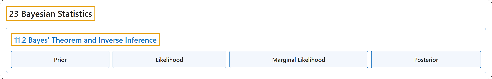

# 11.2 Bayes' Theorem and Inverse Inference

## Classification

## Glossary

| Term | Definition | 中文翻译 | Source |
|---|---|---|---|
| **11.2 Bayes' Theorem and Inverse Inference** 贝叶斯定理与逆推断 | (No definition) | （无定义） | [Poldrack, 2023, section 11.2](https://statsthinking21.github.io/statsthinking21-core-site/bayesian-statistics.html#bayes-theorem-and-inverse-inference) |
| **Prior** 先验 | "**prior** ($P(\text{Hypothesis})$): Our **degree of belief** about hypothesis $H$ before seeing the data $D$" | **先验**（$P(\text{Hypothesis})$）：在看到数据 $D$ 之前，我们对假设 $H$ 的**信念程度** | [Poldrack, 2023, section 11.2](https://statsthinking21.github.io/statsthinking21-core-site/bayesian-statistics.html) |
| **Likelihood** 似然 | "**likelihood** ($P(\text{Data} \vert \text{Hypothesis})$): **How likely are the observed data** $D$ under hypothesis $H$?" | **似然**（$P(\text{Data} \vert \text{Hypothesis})$）：在假设 $H$ 下，观测到数据 $D$ 的**可能性有多大**？ | [Poldrack, 2023, section 11.2](https://statsthinking21.github.io/statsthinking21-core-site/bayesian-statistics.html) |
| **Marginal Likelihood** 边际似然 | "**marginal likelihood** ($P(\text{Data})$): **How likely are the observed data**, combining over all possible hypotheses?" | **边际似然**（$P(\text{Data})$）：综合所有可能的假设，观测到数据的**可能性有多大**？ | [Poldrack, 2023, section 11.2](https://statsthinking21.github.io/statsthinking21-core-site/bayesian-statistics.html) |
| **Posterior** 后验 | "**posterior** ($P(\text{Hypothesis} \vert \text{Data})$): Our **updated belief** about hypothesis $H$, given the data $D$" | **后验**（$P(\text{Hypothesis} \vert \text{Data})$）：给定数据 $D$，我们对假设 $H$ 的**更新后的信念** | [Poldrack, 2023, section 11.2](https://statsthinking21.github.io/statsthinking21-core-site/bayesian-statistics.html) |

## References

Poldrack, R. A. (2023). *Statistical thinking for the 21st century*. Retrieved October 29, 2026, from <https://statsthinking21.github.io/statsthinking21-core-site/>
