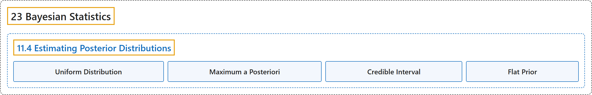

# 11.4 Estimating Posterior Distributions

## Classification

## Glossary

| Term | Definition | 中文翻译 | Source |
|---|---|---|---|
| **11.4 Estimating Posterior Distributions** 估计后验分布 | (No definition) | （无定义） | [Poldrack, 2023, section 11.4](https://statsthinking21.github.io/statsthinking21-core-site/bayesian-statistics.html#estimating-posterior-distributions) |
| **Uniform Distribution** 均匀分布 | "In this case, we don’t have any prior information about the effectiveness of the drug, so we will use a **uniform distribution** as our prior, since all values are equally likely under a uniform distribution." | 在这种情况下，我们没有关于药物有效性的任何先验信息，因此我们将使用**均匀分布**作为先验，因为在均匀分布下所有取值的可能性相同。 | [Poldrack, 2023, section 11.4.1](https://statsthinking21.github.io/statsthinking21-core-site/bayesian-statistics.html) |
| **Maximum a Posteriori** 最大后验 | "One way to do this is to find the value of $p_{respond}$ for which **the posterior probability is the highest**, which we refer to as the **maximum a posteriori** (MAP) estimate." | 一种做法是找到使**后验概率最高**的 $p_{respond}$ 的值，我们称之为**最大后验**（MAP）估计。 | [Poldrack, 2023, section 11.4.6](https://statsthinking21.github.io/statsthinking21-core-site/bayesian-statistics.html) |
| **Credible Interval** 可信区间 | "What we really want is an interval in which we are confident that the true parameter falls, and Bayesian statistics can give us such an interval, which we call a **credible interval**." | 我们真正想要的是一个我们确信真实参数落入其中的区间，而贝叶斯统计可以给出这样的区间，我们称之为**可信区间**。 | [Poldrack, 2023, section 11.4.7](https://statsthinking21.github.io/statsthinking21-core-site/bayesian-statistics.html) |
| **Flat Prior** 平坦先验 | "In the previous example we used a **flat prior**, meaning that we didn’t have any reason to believe that any particular value of $p_{respond}$ was more or less likely." | 在上一个例子中，我们使用了**平坦先验**，意思是我们没有任何理由认为 $p_{respond}$ 的某个特定取值更可能或更不可能。 | [Poldrack, 2023, section 11.4.8](https://statsthinking21.github.io/statsthinking21-core-site/bayesian-statistics.html) |

## References

Poldrack, R. A. (2023). *Statistical thinking for the 21st century*. Retrieved October 29, 2026, from <https://statsthinking21.github.io/statsthinking21-core-site/>
