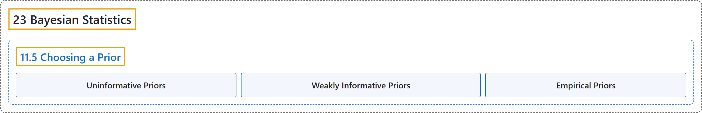

# 11.5 Choosing a Prior

## Classification

## Glossary

| Term | Definition | 中文翻译 | Source |
|---|---|---|---|
| **11.5 Choosing a Prior** 选择先验 | (No definition) | （无定义） | [Poldrack, 2023, section 11.5](https://statsthinking21.github.io/statsthinking21-core-site/bayesian-statistics.html#choosing-a-prior) |
| **Uninformative Priors** 无信息先验 | "**Uninformative priors** attempt to influence the resulting posterior as little as possible, as we saw in the example of the uniform prior above." | **无信息先验**试图尽可能少地影响所得的后验，正如我们在上面均匀先验的例子中所看到的。 | [Poldrack, 2023, section 11.5](https://statsthinking21.github.io/statsthinking21-core-site/bayesian-statistics.html) |
| **Weakly Informative Priors** 弱信息先验 | "It’s also common to use **weakly informative priors** (or default priors), which influence the result only very slightly." | 使用**弱信息先验**（或默认先验）也很常见，它们对结果只有非常轻微的影响。 | [Poldrack, 2023, section 11.5](https://statsthinking21.github.io/statsthinking21-core-site/bayesian-statistics.html) |
| **Empirical Priors** 经验先验 | "It is also possible to use priors based on the scientific literature or pre-existing data, which we would call **empirical priors**." | 也可以使用基于科学文献或已有数据的先验，我们称之为**经验先验**。 | [Poldrack, 2023, section 11.5](https://statsthinking21.github.io/statsthinking21-core-site/bayesian-statistics.html) |

## References

Poldrack, R. A. (2023). *Statistical thinking for the 21st century*. Retrieved October 29, 2026, from <https://statsthinking21.github.io/statsthinking21-core-site/>
