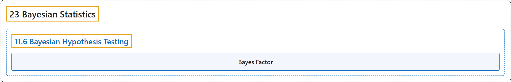

# 11.6 Bayesian Hypothesis Testing

## Classification

## Glossary

| Term | Definition | 中文翻译 | Source |
|---|---|---|---|
| **11.6 Bayesian Hypothesis Testing** 贝叶斯假设检验 | (No definition) | （无定义） | [Poldrack, 2023, section 11.6](https://statsthinking21.github.io/statsthinking21-core-site/bayesian-statistics.html#bayesian-hypothesis-testing) |
| **Bayes Factor** 贝叶斯因子 | "The **Bayes factor** characterizes the relative likelihood of the data under two different hypotheses." | **贝叶斯因子**刻画了在两个不同假设下数据的相对似然。 | [Poldrack, 2023, section 11.6.1](https://statsthinking21.github.io/statsthinking21-core-site/bayesian-statistics.html) |

## References

Poldrack, R. A. (2023). *Statistical thinking for the 21st century*. Retrieved October 29, 2026, from <https://statsthinking21.github.io/statsthinking21-core-site/>
