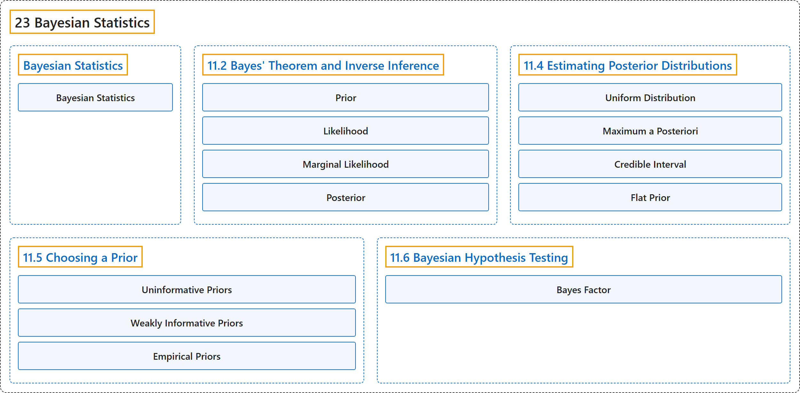

# 23 Bayesian Statistics

## Classification

## Glossary

| Term | Definition | 中文翻译 | Source |
|---|---|---|---|
| **23 Bayesian Statistics** 贝叶斯统计 | (No definition) | （无定义） | [Poldrack, 2023, chapter 11](https://statsthinking21.github.io/statsthinking21-core-site/bayesian-statistics.html) |
| **Bayesian Statistics** 贝叶斯统计 | "In this chapter we will take up **the approach to statistical modeling and inference** that stands in contrast to the null hypothesis testing framework that you encountered in Chapter 9." | 在本章中，我们将讨论与你在第9章中遇到的零假设检验框架相对立的**统计建模与推断方法**。 | [Poldrack, 2023, section 11](https://statsthinking21.github.io/statsthinking21-core-site/bayesian-statistics.html) |
| **[11.2 Bayes' Theorem and Inverse Inference](11-2-bayes-theorem-and-inverse-inference.md)** 贝叶斯定理与逆推断 | (No definition) | （无定义） | [Poldrack, 2023, section 11.2](https://statsthinking21.github.io/statsthinking21-core-site/bayesian-statistics.html#bayes-theorem-and-inverse-inference) |
| **[11.4 Estimating Posterior Distributions](11-4-estimating-posterior-distributions.md)** 估计后验分布 | (No definition) | （无定义） | [Poldrack, 2023, section 11.4](https://statsthinking21.github.io/statsthinking21-core-site/bayesian-statistics.html#estimating-posterior-distributions) |
| **[11.5 Choosing a Prior](11-5-choosing-a-prior.md)** 选择先验 | (No definition) | （无定义） | [Poldrack, 2023, section 11.5](https://statsthinking21.github.io/statsthinking21-core-site/bayesian-statistics.html#choosing-a-prior) |
| **[11.6 Bayesian Hypothesis Testing](11-6-bayesian-hypothesis-testing.md)** 贝叶斯假设检验 | (No definition) | （无定义） | [Poldrack, 2023, section 11.6](https://statsthinking21.github.io/statsthinking21-core-site/bayesian-statistics.html#bayesian-hypothesis-testing) |

## References

Poldrack, R. A. (2023). *Statistical thinking for the 21st century*. Retrieved October 29, 2026, from <https://statsthinking21.github.io/statsthinking21-core-site/>
