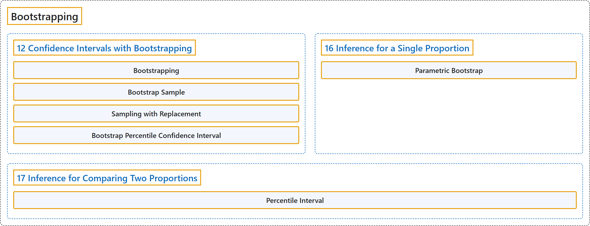

# 20 Bootstrapping

## Classification

## Glossary

| Term | Definition | 中文翻译 | Source |
|---|---|---|---|
| **20 Bootstrapping** 自助法 | (No definition) | （无定义） | [Çetinkaya-Rundel & Hardin, 2024](https://openintro-ims.netlify.app/) |
| **12 Confidence Intervals with Bootstrapping** 基于自助法的置信区间 | (No definition) | （无定义） | [Çetinkaya-Rundel & Hardin, 2024, chapter 12](https://openintro-ims.netlify.app/foundations-bootstrapping.html) |
| **Bootstrapping** 自助法 | "So, instead of using a “resample from the population” approach, **bootstrapping** uses a “**resample from the sample**” approach." | 因此，**自助法**不采用“从总体中重新抽样”的做法，而是采用“**从样本中重新抽样**”的做法。 | [Çetinkaya-Rundel & Hardin, 2024, chapter 12 introduction](https://openintro-ims.netlify.app/foundations-bootstrapping.html#:~:text=So%2C%20instead%20of%20using%20a%20%E2%80%9Cresample) |
| **Bootstrap Sample** 自助样本 | "As we saw above, a **bootstrap sample** is a **sample of the original sample**." | 如上所述，**自助样本**是**原始样本的一个样本**。 | [Çetinkaya-Rundel & Hardin, 2024, section 12.3](https://openintro-ims.netlify.app/foundations-bootstrapping.html#:~:text=As%20we%20saw%20above%2C%20a%20bootstrap) |
| **Sampling with Replacement** 有放回抽样 | "Bootstrap sampling is often called **sampling with replacement**." | 自助抽样通常被称为**有放回抽样**。 | [Çetinkaya-Rundel & Hardin, 2024, section 12.3](https://openintro-ims.netlify.app/foundations-bootstrapping.html#:~:text=Bootstrap%20sampling%20is%20often%20called%20sampling) |
| **Bootstrap Percentile Confidence Interval** 自助百分位置信区间 | "The range of values for the true proportion is called a **bootstrap percentile confidence interval**, and we will see it again throughout the next few sections and chapters." | 真实比例的取值范围称为**自助百分位置信区间**，在接下来的几节和几章中我们还会再次见到它。 | [Çetinkaya-Rundel & Hardin, 2024, section 12.1](https://openintro-ims.netlify.app/foundations-bootstrapping.html#:~:text=The%20range%20of%20values%20for%20the) |
| **16 Inference for a Single Proportion** 单个比例的推断 | (No definition) | （无定义） | [Çetinkaya-Rundel & Hardin, 2024, chapter 16](https://openintro-ims.netlify.app/inference-one-prop.html) |
| **Parametric Bootstrap** 参数自助法 | "Simulating observations using a hypothesized null parameter value is often called a **parametric bootstrap** simulation, but we will refer to it descriptively as “simulating under the null hypothesis claim.”" | 使用假设的原假设参数值来模拟观测，通常称为**参数自助法**模拟，但我们将用描述性的说法称之为“在原假设声明下进行模拟”。 | [Çetinkaya-Rundel & Hardin, 2024, section 16.1](https://openintro-ims.netlify.app/inference-one-prop.html#:~:text=Simulating%20observations%20using%20a%20hypothesized%20null) |
| **17 Inference for Comparing Two Proportions** 两个比例比较的推断 | (No definition) | （无定义） | [Çetinkaya-Rundel & Hardin, 2024, chapter 17](https://openintro-ims.netlify.app/inference-two-props.html) |
| **Percentile Interval** 百分位数区间 | "The interval created from the **percentiles of the distribution** is called the **percentile interval**." | 由分布的**百分位数**所构造的区间称为**百分位数区间**。 | [Çetinkaya-Rundel & Hardin, 2024, section 17.2](https://openintro-ims.netlify.app/inference-two-props.html#:~:text=The%20interval%20created%20from%20the%20percentiles) |

## References

Çetinkaya-Rundel, M., & Hardin, J. (2024). *Introduction to modern statistics* (2nd ed.). OpenIntro. Retrieved October 28, 2026, from <https://openintro-ims.netlify.app/>
