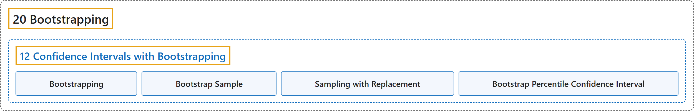

# 12 Confidence Intervals with Bootstrapping

## Classification

## Glossary

| Term | Definition | 中文翻译 | Source |
|---|---|---|---|
| **12 Confidence Intervals with Bootstrapping** 基于自助法的置信区间 | (No definition) | （无定义） | [Çetinkaya-Rundel & Hardin, 2024, chapter 12](https://openintro-ims.netlify.app/foundations-bootstrapping.html) |
| **Bootstrapping** 自助法 | "So, instead of using a “resample from the population” approach, **bootstrapping** uses a “**resample from the sample**” approach." | 因此，**自助法**不采用“从总体中重新抽样”的做法，而是采用“**从样本中重新抽样**”的做法。 | [Çetinkaya-Rundel & Hardin, 2024, chapter 12 introduction](https://openintro-ims.netlify.app/foundations-bootstrapping.html#:~:text=So%2C%20instead%20of%20using%20a%20%E2%80%9Cresample) |
| **Bootstrap Sample** 自助样本 | "As we saw above, a **bootstrap sample** is a **sample of the original sample**." | 如上所述，**自助样本**是**原始样本的一个样本**。 | [Çetinkaya-Rundel & Hardin, 2024, section 12.3](https://openintro-ims.netlify.app/foundations-bootstrapping.html#:~:text=As%20we%20saw%20above%2C%20a%20bootstrap) |
| **Sampling with Replacement** 有放回抽样 | "Bootstrap sampling is often called **sampling with replacement**." | 自助抽样通常被称为**有放回抽样**。 | [Çetinkaya-Rundel & Hardin, 2024, section 12.3](https://openintro-ims.netlify.app/foundations-bootstrapping.html#:~:text=Bootstrap%20sampling%20is%20often%20called%20sampling) |
| **Bootstrap Percentile Confidence Interval** 自助百分位置信区间 | "The range of values for the true proportion is called a **bootstrap percentile confidence interval**, and we will see it again throughout the next few sections and chapters." | 真实比例的取值范围称为**自助百分位置信区间**，在接下来的几节和几章中我们还会再次见到它。 | [Çetinkaya-Rundel & Hardin, 2024, section 12.1](https://openintro-ims.netlify.app/foundations-bootstrapping.html#:~:text=The%20range%20of%20values%20for%20the) |

## References

Çetinkaya-Rundel, M., & Hardin, J. (2024). *Introduction to modern statistics* (2nd ed.). OpenIntro. Retrieved October 28, 2026, from <https://openintro-ims.netlify.app/>
