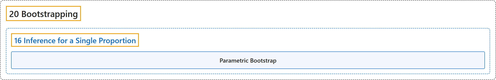

# 16 Inference for a Single Proportion

## Classification

## Glossary

| Term | Definition | 中文翻译 | Source |
|---|---|---|---|
| **16 Inference for a Single Proportion** 单个比例的推断 | (No definition) | （无定义） | [Çetinkaya-Rundel & Hardin, 2024, chapter 16](https://openintro-ims.netlify.app/inference-one-prop.html) |
| **Parametric Bootstrap** 参数自助法 | "Simulating observations using a hypothesized null parameter value is often called a **parametric bootstrap** simulation, but we will refer to it descriptively as “simulating under the null hypothesis claim.”" | 使用假设的原假设参数值来模拟观测，通常称为**参数自助法**模拟，但我们将用描述性的说法称之为“在原假设声明下进行模拟”。 | [Çetinkaya-Rundel & Hardin, 2024, section 16.1](https://openintro-ims.netlify.app/inference-one-prop.html#:~:text=Simulating%20observations%20using%20a%20hypothesized%20null) |

## References

Çetinkaya-Rundel, M., & Hardin, J. (2024). *Introduction to modern statistics* (2nd ed.). OpenIntro. Retrieved October 28, 2026, from <https://openintro-ims.netlify.app/>
