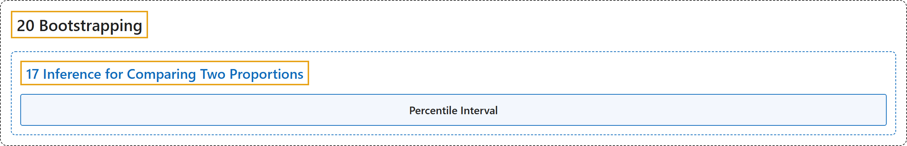

# 17 Inference for Comparing Two Proportions

## Classification

## Glossary

| Term | Definition | 中文翻译 | Source |
|---|---|---|---|
| **17 Inference for Comparing Two Proportions** 两个比例比较的推断 | (No definition) | （无定义） | [Çetinkaya-Rundel & Hardin, 2024, chapter 17](https://openintro-ims.netlify.app/inference-two-props.html) |
| **Percentile Interval** 百分位数区间 | "The interval created from the **percentiles of the distribution** is called the **percentile interval**." | 由分布的**百分位数**所构造的区间称为**百分位数区间**。 | [Çetinkaya-Rundel & Hardin, 2024, section 17.2](https://openintro-ims.netlify.app/inference-two-props.html#:~:text=The%20interval%20created%20from%20the%20percentiles) |

## References

Çetinkaya-Rundel, M., & Hardin, J. (2024). *Introduction to modern statistics* (2nd ed.). OpenIntro. Retrieved October 28, 2026, from <https://openintro-ims.netlify.app/>
