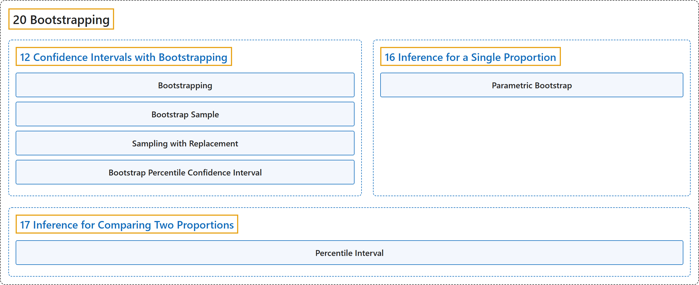

# 20 Bootstrapping

## Classification

## Glossary

| Term | Definition | 中文翻译 | Source |
|---|---|---|---|
| **20 Bootstrapping** 自助法 | (No definition) | （无定义） | [Çetinkaya-Rundel & Hardin, 2024](https://openintro-ims.netlify.app/) |
| **[12 Confidence Intervals with Bootstrapping](12-confidence-intervals-with-bootstrapping.md)** 基于自助法的置信区间 | (No definition) | （无定义） | [Çetinkaya-Rundel & Hardin, 2024, chapter 12](https://openintro-ims.netlify.app/foundations-bootstrapping.html) |
| **[16 Inference for a Single Proportion](16-inference-for-a-single-proportion.md)** 单个比例的推断 | (No definition) | （无定义） | [Çetinkaya-Rundel & Hardin, 2024, chapter 16](https://openintro-ims.netlify.app/inference-one-prop.html) |
| **[17 Inference for Comparing Two Proportions](17-inference-for-comparing-two-proportions.md)** 两个比例比较的推断 | (No definition) | （无定义） | [Çetinkaya-Rundel & Hardin, 2024, chapter 17](https://openintro-ims.netlify.app/inference-two-props.html) |

## References

Çetinkaya-Rundel, M., & Hardin, J. (2024). *Introduction to modern statistics* (2nd ed.). OpenIntro. Retrieved October 28, 2026, from <https://openintro-ims.netlify.app/>
