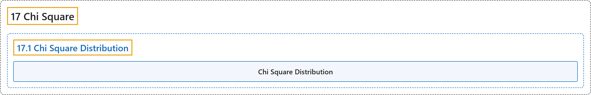

# 17.1 Chi Square Distribution

## Classification

## Glossary

| Term | Definition | 中文翻译 | Source |
|---|---|---|---|
| **17.1 Chi Square Distribution** 卡方分布 | (No definition) | （无定义） | [Online Statistics Education, n.d., section 17.1](https://onlinestatbook.com/2/chi_square/distribution.html) |
| **Chi Square Distribution** 卡方分布 | "The **Chi Square distribution** is the distribution of the **sum of squared standard normal deviates**." | **卡方分布**是**标准正态离差平方和**的分布。 | [Online Statistics Education, n.d., section 17.1](https://onlinestatbook.com/2/chi_square/distribution.html) |

## References

*Online statistics education: An interactive multimedia course of study*. (n.d.). Rice University, University of Houston Clear Lake, and Tufts University. Retrieved October 29, 2026, from <https://onlinestatbook.com/2/>
