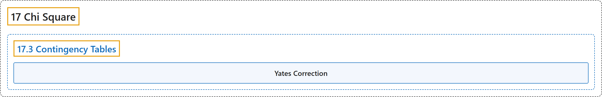

# 17.3 Contingency Tables

## Classification

## Glossary

| Term | Definition | 中文翻译 | Source |
|---|---|---|---|
| **17.3 Contingency Tables** 列联表 | (No definition) | （无定义） | [Online Statistics Education, n.d., section 17.3](https://onlinestatbook.com/2/chi_square/contingency.html) |
| **Yates Correction** 耶茨校正 | "The **correction for continuity** when applied to 2 x 2 contingency tables is called the **Yates correction**." | 用于 2 x 2 列联表的**连续性校正**称为**耶茨校正**。 | [Online Statistics Education, n.d., section 17.3](https://onlinestatbook.com/2/chi_square/contingency.html) |

## References

*Online statistics education: An interactive multimedia course of study*. (n.d.). Rice University, University of Houston Clear Lake, and Tufts University. Retrieved October 29, 2026, from <https://onlinestatbook.com/2/>
