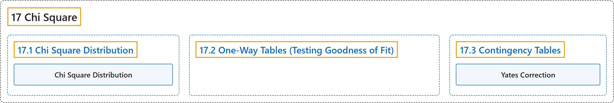

# 17 Chi Square

## Classification

## Glossary

| Term | Definition | 中文翻译 | Source |
|---|---|---|---|
| **17 Chi Square** 卡方 | (No definition) | （无定义） | [Online Statistics Education, n.d., chapter 17](https://onlinestatbook.com/2/chi_square/Chi_Square.html) |
| **[17.1 Chi Square Distribution](17-1-chi-square-distribution.md)** 卡方分布 | (No definition) | （无定义） | [Online Statistics Education, n.d., section 17.1](https://onlinestatbook.com/2/chi_square/distribution.html) |
| **[17.2 One-Way Tables (Testing Goodness of Fit)](17-2-one-way-tables-testing-goodness-of-fit.md)** 单向表（拟合优度检验） | (No definition) | （无定义） | [Online Statistics Education, n.d., section 17.2](https://onlinestatbook.com/2/chi_square/one-way.html) |
| **[17.3 Contingency Tables](17-3-contingency-tables.md)** 列联表 | (No definition) | （无定义） | [Online Statistics Education, n.d., section 17.3](https://onlinestatbook.com/2/chi_square/contingency.html) |

## References

*Online statistics education: An interactive multimedia course of study*. (n.d.). Rice University, University of Houston Clear Lake, and Tufts University. Retrieved October 29, 2026, from <https://onlinestatbook.com/2/>
