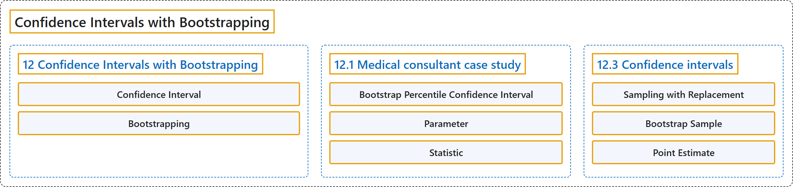

# 12 Confidence Intervals with Bootstrapping

## Classification

## Glossary

| Term | Definition | 中文翻译 | Source |
|---|---|---|---|
| **12 Confidence Intervals with Bootstrapping** 基于自助法的置信区间 | (No definition) | （无定义） | [Çetinkaya-Rundel & Hardin, 2024, chapter 12](https://openintro-ims.netlify.app/foundations-bootstrapping.html) |
| **Confidence Interval** 置信区间 | "That is, we create what is called a **confidence interval**, which is a **range of plausible values** where we may find the true population value." | 也就是说，我们要构造所谓的**置信区间**，它是一个我们可能在其中找到真实总体值的**合理取值范围**。 | [Çetinkaya-Rundel & Hardin, 2024, chapter 12 introduction](https://openintro-ims.netlify.app/foundations-bootstrapping.html#:~:text=That%20is%2C%20we%20create%20what%20is) |
| **Bootstrapping** 自助法 | "So, instead of using a “resample from the population” approach, **bootstrapping** uses a “**resample from the sample**” approach." | 因此，**自助法**不采用“从总体中重新抽样”的做法，而是采用“**从样本中重新抽样**”的做法。 | [Çetinkaya-Rundel & Hardin, 2024, chapter 12 introduction](https://openintro-ims.netlify.app/foundations-bootstrapping.html#:~:text=So%2C%20instead%20of%20using%20a%20%E2%80%9Cresample) |
| **12.1 Medical consultant case study** 案例研究：医疗顾问 | (No definition) | （无定义） | [Çetinkaya-Rundel & Hardin, 2024, section 12.1](https://openintro-ims.netlify.app/foundations-bootstrapping.html#sec-case-study-med-consult) |
| **Bootstrap Percentile Confidence Interval** 自助百分位置信区间 | "The range of values for the true proportion is called a **bootstrap percentile confidence interval**, and we will see it again throughout the next few sections and chapters." | 真实比例的取值范围称为**自助百分位置信区间**，在接下来的几节和几章中我们还会再次见到它。 | [Çetinkaya-Rundel & Hardin, 2024, section 12.1](https://openintro-ims.netlify.app/foundations-bootstrapping.html#:~:text=The%20range%20of%20values%20for%20the) |
| **Parameter** 参数 | "A **parameter** is the “true” **value of interest**. We typically estimate the parameter using a point estimate from a sample of data." | **参数**是所关注的“真实”**值**。我们通常利用样本数据的点估计来估计参数。 | [Çetinkaya-Rundel & Hardin, 2024, section 12.1](https://openintro-ims.netlify.app/foundations-bootstrapping.html#:~:text=A%20parameter%20is%20the%20%E2%80%9Ctrue%E2%80%9D%20value) |
| **Statistic** 统计量 | "We typically estimate the parameter using a point estimate from a sample of data. The **point estimate** is also known as the **statistic**." | 我们通常利用样本数据的点估计来估计参数。**点估计**也称为**统计量**。 | [Çetinkaya-Rundel & Hardin, 2024, section 12.1](https://openintro-ims.netlify.app/foundations-bootstrapping.html#:~:text=We%20typically%20estimate%20the%20parameter%20using) |
| **12.3 Confidence intervals** 置信区间 | (No definition) | （无定义） | [Çetinkaya-Rundel & Hardin, 2024, section 12.3](https://openintro-ims.netlify.app/foundations-bootstrapping.html#sec-ConfidenceIntervals) |
| **Sampling with Replacement** 有放回抽样 | "Bootstrap sampling is often called **sampling with replacement**." | 自助抽样通常被称为**有放回抽样**。 | [Çetinkaya-Rundel & Hardin, 2024, section 12.3](https://openintro-ims.netlify.app/foundations-bootstrapping.html#:~:text=Bootstrap%20sampling%20is%20often%20called%20sampling) |
| **Bootstrap Sample** 自助样本 | "As we saw above, a **bootstrap sample** is a **sample of the original sample**." | 如上所述，**自助样本**是**原始样本的一个样本**。 | [Çetinkaya-Rundel & Hardin, 2024, section 12.3](https://openintro-ims.netlify.app/foundations-bootstrapping.html#:~:text=As%20we%20saw%20above%2C%20a%20bootstrap) |
| **Point Estimate** 点估计 | "A **point estimate** provides a **single plausible value for a parameter**. However, a point estimate is rarely perfect; usually there is some error in the estimate." | **点估计**为参数提供**单个合理值**。然而，点估计很少是完美的，估计中通常存在一定误差。 | [Çetinkaya-Rundel & Hardin, 2024, section 12.3](https://openintro-ims.netlify.app/foundations-bootstrapping.html#:~:text=A%20point%20estimate%20provides%20a%20single) |

## References

Çetinkaya-Rundel, M., & Hardin, J. (2024). *Introduction to modern statistics* (2nd ed.). OpenIntro. Retrieved October 28, 2026, from <https://openintro-ims.netlify.app/>
