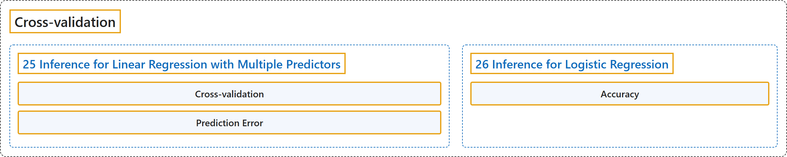

# 22 Cross-validation

## Classification

## Glossary

| Term | Definition | 中文翻译 | Source |
|---|---|---|---|
| **22 Cross-validation** 交叉验证 | (No definition) | （无定义） | [Çetinkaya-Rundel & Hardin, 2024](https://openintro-ims.netlify.app/) |
| **25 Inference for Linear Regression with Multiple Predictors** 多预测变量线性回归的推断 | (No definition) | （无定义） | [Çetinkaya-Rundel & Hardin, 2024, chapter 25](https://openintro-ims.netlify.app/inf-model-mlr.html) |
| **Cross-validation** 交叉验证 | "In addition to model building, **cross-validation** provides a method for generating predictions that are not **overfit** to the particular dataset at hand." | 除了模型构建之外，**交叉验证**还提供了一种生成预测的方法，这些预测不会对手头的特定数据集**过拟合**。 | [Çetinkaya-Rundel & Hardin, 2024, section 25.3](https://openintro-ims.netlify.app/inf-model-mlr.html#:~:text=In%20addition%20to%20model%20building%2C%20cross-validation) |
| **Prediction Error** 预测误差 | "Here, we use **cross-validation prediction error** to focus on which variable(s) are important for predicting the response variable of interest." | 在这里，我们使用**交叉验证预测误差**来关注哪些变量对预测所关注的响应变量是重要的。 | [Çetinkaya-Rundel & Hardin, 2024, section 25.3](https://openintro-ims.netlify.app/inf-model-mlr.html#:~:text=Here%2C%20we%20use%20cross-validation%20prediction%20error) |
| **26 Inference for Logistic Regression** 逻辑斯谛回归的推断 | (No definition) | （无定义） | [Çetinkaya-Rundel & Hardin, 2024, chapter 26](https://openintro-ims.netlify.app/inf-model-logistic.html) |
| **Accuracy** 准确率 | "Here we present a method for using **cross-validation accuracy** to determine which variables (if any) should be used in a model which predicts whether an email is spam." | 这里我们介绍一种利用**交叉验证准确率**来确定在预测电子邮件是否为垃圾邮件的模型中应使用哪些变量（如果有的话）的方法。 | [Çetinkaya-Rundel & Hardin, 2024, section 26.3](https://openintro-ims.netlify.app/inf-model-logistic.html#:~:text=Here%20we%20present%20a%20method%20for) |

## References

Çetinkaya-Rundel, M., & Hardin, J. (2024). *Introduction to modern statistics* (2nd ed.). OpenIntro. Retrieved October 28, 2026, from <https://openintro-ims.netlify.app/>
