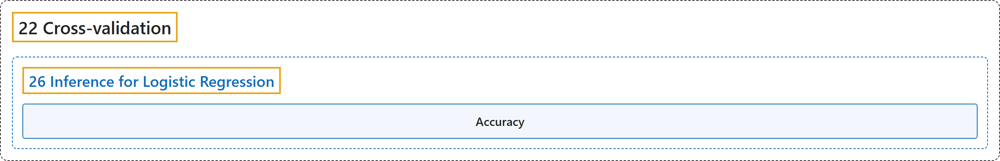

# 26 Inference for Logistic Regression

## Classification

## Glossary

| Term | Definition | 中文翻译 | Source |
|---|---|---|---|
| **26 Inference for Logistic Regression** 逻辑斯谛回归的推断 | (No definition) | （无定义） | [Çetinkaya-Rundel & Hardin, 2024, chapter 26](https://openintro-ims.netlify.app/inf-model-logistic.html) |
| **Accuracy** 准确率 | "Here we present a method for using **cross-validation accuracy** to determine which variables (if any) should be used in a model which predicts whether an email is spam." | 这里我们介绍一种利用**交叉验证准确率**来确定在预测电子邮件是否为垃圾邮件的模型中应使用哪些变量（如果有的话）的方法。 | [Çetinkaya-Rundel & Hardin, 2024, section 26.3](https://openintro-ims.netlify.app/inf-model-logistic.html#:~:text=Here%20we%20present%20a%20method%20for) |

## References

Çetinkaya-Rundel, M., & Hardin, J. (2024). *Introduction to modern statistics* (2nd ed.). OpenIntro. Retrieved October 28, 2026, from <https://openintro-ims.netlify.app/>
