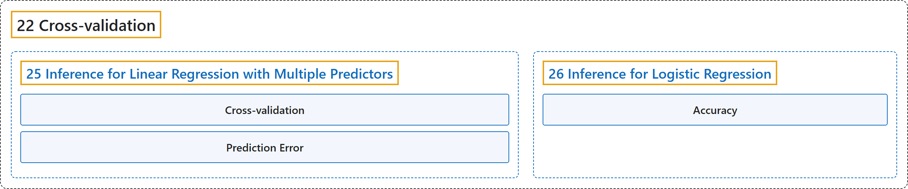

# 22 Cross-validation

## Classification

## Glossary

| Term | Definition | 中文翻译 | Source |
|---|---|---|---|
| **22 Cross-validation** 交叉验证 | (No definition) | （无定义） | [Çetinkaya-Rundel & Hardin, 2024](https://openintro-ims.netlify.app/) |
| **[25 Inference for Linear Regression with Multiple Predictors](25-inference-for-linear-regression-with-multiple-predictors.md)** 多预测变量线性回归的推断 | (No definition) | （无定义） | [Çetinkaya-Rundel & Hardin, 2024, chapter 25](https://openintro-ims.netlify.app/inf-model-mlr.html) |
| **[26 Inference for Logistic Regression](26-inference-for-logistic-regression.md)** 逻辑斯谛回归的推断 | (No definition) | （无定义） | [Çetinkaya-Rundel & Hardin, 2024, chapter 26](https://openintro-ims.netlify.app/inf-model-logistic.html) |

## References

Çetinkaya-Rundel, M., & Hardin, J. (2024). *Introduction to modern statistics* (2nd ed.). OpenIntro. Retrieved October 28, 2026, from <https://openintro-ims.netlify.app/>
