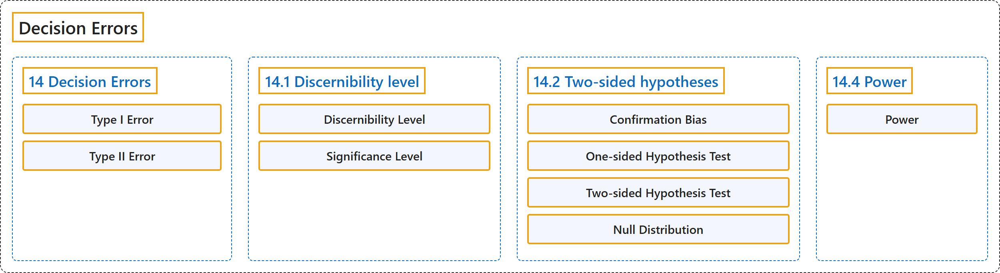

# 14 Decision Errors

## Classification

## Glossary

| Term | Definition | 中文翻译 | Source |
|---|---|---|---|
| **14 Decision Errors** 决策错误 | (No definition) | （无定义） | [Çetinkaya-Rundel & Hardin, 2024, chapter 14](https://openintro-ims.netlify.app/foundations-errors.html) |
| **Type I Error** 第一类错误 | "A **Type I error** is **rejecting the null hypothesis** when $H_0$ is actually true." | **第一类错误**是在 $H_0$ 实际为真时**拒绝原假设**。 | [Çetinkaya-Rundel & Hardin, 2024, chapter 14 introduction](https://openintro-ims.netlify.app/foundations-errors.html#:~:text=A%20Type%20I%20error%20is%20rejecting) |
| **Type II Error** 第二类错误 | "A **Type II error** is **failing to reject the null hypothesis** when the alternative is actually true." | **第二类错误**是在备择假设实际为真时**未能拒绝原假设**。 | [Çetinkaya-Rundel & Hardin, 2024, chapter 14 introduction](https://openintro-ims.netlify.app/foundations-errors.html#:~:text=A%20Type%20II%20error%20is%20failing) |
| **14.1 Discernibility level** 显著性水平 | (No definition) | （无定义） | [Çetinkaya-Rundel & Hardin, 2024, section 14.1](https://openintro-ims.netlify.app/foundations-errors.html#discernibility-level) |
| **Discernibility Level** 显著性水平 | "The **discernibility level** provides the **cutoff for the p-value** which will lead to a decision of “reject the null hypothesis.”" | **显著性水平**给出 **p 值的临界值**，p 值低于该值就会做出“拒绝原假设”的决定。 | [Çetinkaya-Rundel & Hardin, 2024, section 14.1](https://openintro-ims.netlify.app/foundations-errors.html#:~:text=The%20discernibility%20level%20provides%20the%20cutoff) |
| **Significance Level** 显著性水平 | "The **discernibility level** provides the **cutoff for the p-value** which will lead to a decision of “reject the null hypothesis.”" | **显著性水平**给出 **p 值的临界值**，p 值低于该值就会做出“拒绝原假设”的决定。 | [Çetinkaya-Rundel & Hardin, 2024, section 14.1](https://openintro-ims.netlify.app/foundations-errors.html#:~:text=The%20discernibility%20level%20provides%20the%20cutoff) |
| **14.2 Two-sided hypotheses** 双侧假设 | (No definition) | （无定义） | [Çetinkaya-Rundel & Hardin, 2024, section 14.2](https://openintro-ims.netlify.app/foundations-errors.html#sec-two-sided-hypotheses) |
| **Confirmation Bias** 确认偏差 | "If we only use alternative hypotheses that agree with our worldview, then we are going to be subjecting ourselves to **confirmation bias**, which means we are **looking for data that supports our ideas**." | 如果我们只使用与自己的世界观一致的备择假设，就会让自己陷入**确认偏差**，也就是说我们在**寻找支持自己想法的数据**。 | [Çetinkaya-Rundel & Hardin, 2024, section 14.2](https://openintro-ims.netlify.app/foundations-errors.html#:~:text=If%20we%20only%20use%20alternative%20hypotheses) |
| **One-sided Hypothesis Test** 单侧假设检验 | "The original hypotheses we have seen are called **one-sided hypothesis tests** because they only explored **one direction of possibilities**." | 我们此前见过的最初假设被称为**单侧假设检验**，因为它们只探讨了**一个方向的可能性**。 | [Çetinkaya-Rundel & Hardin, 2024, section 14.2](https://openintro-ims.netlify.app/foundations-errors.html#:~:text=The%20original%20hypotheses%20we%20have%20seen) |
| **Two-sided Hypothesis Test** 双侧假设检验 | "Such hypotheses are appropriate when we are exclusively interested in the single direction, but **usually we want to consider all possibilities**. To do so, let’s learn about **two-sided hypothesis tests** in the context of a new study that examines the impact of using blood thinners on patients who have undergone CPR." | 当我们只关心单一方向时，这类假设是合适的，但通常我们希望考虑**所有的可能性**。为此，让我们结合一项新研究来学习**双侧假设检验**，该研究考察对接受过心肺复苏的患者使用血液稀释剂的影响。 | [Çetinkaya-Rundel & Hardin, 2024, section 14.2](https://openintro-ims.netlify.app/foundations-errors.html#:~:text=Such%20hypotheses%20are%20appropriate%20when%20we) |
| **Null Distribution** 零分布 | "If we repeat this simulation 1,000 times, we can build a **null distribution** of the differences shown in Figure 14.1." | 如果我们将这一模拟重复 1,000 次，就可以构建图 14.1 所示差值的**零分布**。 | [Çetinkaya-Rundel & Hardin, 2024, section 14.2](https://openintro-ims.netlify.app/foundations-errors.html#:~:text=If%20we%20repeat%20this%20simulation%201%2C000) |
| **14.4 Power** 检验功效 | (No definition) | （无定义） | [Çetinkaya-Rundel & Hardin, 2024, section 14.4](https://openintro-ims.netlify.app/foundations-errors.html#sec-pow) |
| **Power** 功效 | "This probability is called the **power**, and we can compute it for different sample sizes or different effect sizes." | 这个概率称为**功效**，我们可以针对不同的样本量或不同的效应量来计算它。 | [Çetinkaya-Rundel & Hardin, 2024, section 14.4](https://openintro-ims.netlify.app/foundations-errors.html#:~:text=This%20probability%20is%20called%20the%20power%2C) |

## References

Çetinkaya-Rundel, M., & Hardin, J. (2024). *Introduction to modern statistics* (2nd ed.). OpenIntro. Retrieved October 28, 2026, from <https://openintro-ims.netlify.app/>
