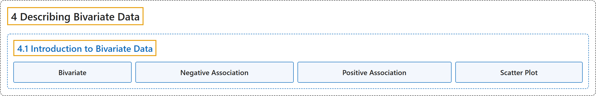

# 4.1 Introduction to Bivariate Data

## Classification

## Glossary

| Term | Definition | 中文翻译 | Source |
|---|---|---|---|
| **4.1 Introduction to Bivariate Data** 二元数据介绍 | (No definition) | （无定义） | [Online Statistics Education, n.d., section 4.1](https://onlinestatbook.com/2/describing_bivariate_data/intro.html) |
| **Bivariate** 双变量 | "**Bivariate** data is data for which there are **two variables for each observation**. As an example, the following bivariate data show the ages of husbands and wives of 10 married couples." | **双变量**数据是**每个观测有两个变量**的数据。例如，下面的双变量数据给出了 10 对已婚夫妇中丈夫和妻子的年龄。 | [Online Statistics Education, n.d., glossary](https://onlinestatbook.com/2/glossary/bivariate.html) |
| **Negative Association** 负关联 | "There is a **negative association** between variables $X$ and $Y$ if smaller values of $X$ are associated with larger values of $Y$ and larger values of $X$ are associated with smaller values of $Y$." | 如果 $X$ 的较小值与 $Y$ 的较大值相关联，且 $X$ 的较大值与 $Y$ 的较小值相关联，则变量 $X$ 与 $Y$ 之间存在**负关联**。 | [Online Statistics Education, n.d., glossary](https://onlinestatbook.com/2/glossary/negative_association.html) |
| **Positive Association** 正关联 | "There is a **positive association** between variables $X$ and $Y$ if smaller values of $X$ are associated with smaller values of $Y$ and larger values of $X$ are associated with larger values of $Y$." | 如果 $X$ 的较小值与 $Y$ 的较小值相关联，且 $X$ 的较大值与 $Y$ 的较大值相关联，则变量 $X$ 与 $Y$ 之间存在**正关联**。 | [Online Statistics Education, n.d., glossary](https://onlinestatbook.com/2/glossary/positive_association.html) |
| **Scatter Plot** 散点图 | "A **scatter plot** of two variables shows the values of one variable on the $Y$ axis and the values of the other variable on the $X$ axis. Scatter plots are well suited for revealing the relationship between two variables. The scatter plot shown below illustrates the relationship between grip strength and arm strength in a sample of workers." | 两个变量的**散点图**在 $Y$ 轴上显示一个变量的值，在 $X$ 轴上显示另一个变量的值。散点图非常适合揭示两个变量之间的关系。下面的散点图说明了一个工人样本中握力与臂力之间的关系。 | [Online Statistics Education, n.d., glossary](https://onlinestatbook.com/2/glossary/scatter_plot.html) |

## References

*Online statistics education: An interactive multimedia course of study*. (n.d.). Rice University, University of Houston Clear Lake, and Tufts University. Retrieved October 29, 2026, from <https://onlinestatbook.com/2/>
