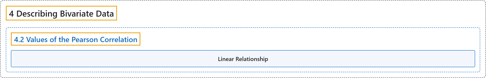

# 4.2 Values of the Pearson Correlation

## Classification

## Glossary

| Term | Definition | 中文翻译 | Source |
|---|---|---|---|
| **4.2 Values of the Pearson Correlation** 皮尔逊相关系数的取值 | (No definition) | （无定义） | [Online Statistics Education, n.d., section 4.2](https://onlinestatbook.com/2/describing_bivariate_data/pearson.html) |
| **Linear Relationship** 线性关系 | "There is a perfect **linear relationship** between two variables if a scatterplot of the points falls on a straight line. The relationship is linear even if the points diverge from the line as long as the divergence is random rather than being systematic." | 如果点的散点图落在一条直线上，则两个变量之间存在完全的**线性关系**。即使点偏离该直线，只要偏离是随机的而不是系统性的，这种关系仍是线性的。 | [Online Statistics Education, n.d., glossary](https://onlinestatbook.com/2/glossary/linear_relationship.html) |

## References

*Online statistics education: An interactive multimedia course of study*. (n.d.). Rice University, University of Houston Clear Lake, and Tufts University. Retrieved October 29, 2026, from <https://onlinestatbook.com/2/>
