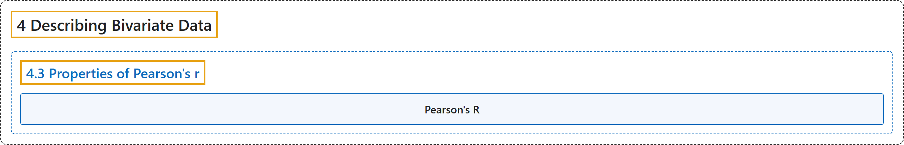

# 4.3 Properties of Pearson's r

## Classification

## Glossary

| Term | Definition | 中文翻译 | Source |
|---|---|---|---|
| **4.3 Properties of Pearson's r** 皮尔逊 r 的性质 | (No definition) | （无定义） | [Online Statistics Education, n.d., section 4.3](https://onlinestatbook.com/2/describing_bivariate_data/properties.html) |
| **Pearson's R** 皮尔逊相关系数 | "**Pearson's correlation** is a **measure of the strength of the linear relationship between two variables**. It ranges from $-1$ for a perfect negative relationship to $+1$ for a perfect positive relationship. A correlation of 0 means that there is no linear relationship." | **皮尔逊相关系数**是**两个变量之间线性关系强度的度量**。其取值范围从完全负相关的 $-1$ 到完全正相关的 $+1$。相关系数为 0 表示不存在线性关系。 | [Online Statistics Education, n.d., glossary](https://onlinestatbook.com/2/glossary/pearson_r.html) |

## References

*Online statistics education: An interactive multimedia course of study*. (n.d.). Rice University, University of Houston Clear Lake, and Tufts University. Retrieved October 29, 2026, from <https://onlinestatbook.com/2/>
