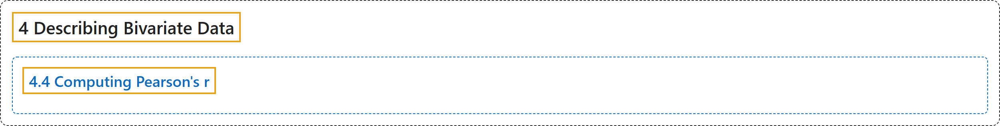

# 4.4 Computing Pearson's r

## Classification

## Glossary

| Term | Definition | 中文翻译 | Source |
|---|---|---|---|
| **4.4 Computing Pearson's r** 计算皮尔逊相关系数 r | (No definition) | （无定义） | [Online Statistics Education, n.d., section 4.4](https://onlinestatbook.com/2/describing_bivariate_data/calculation.html) |

## References

*Online statistics education: An interactive multimedia course of study*. (n.d.). Rice University, University of Houston Clear Lake, and Tufts University. Retrieved October 29, 2026, from <https://onlinestatbook.com/2/>
