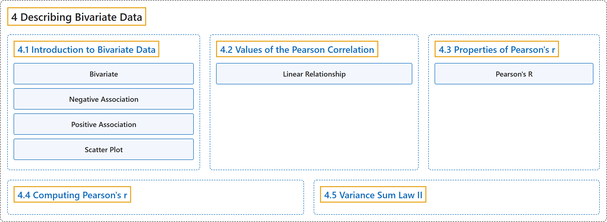

# 4 Describing Bivariate Data

## Classification

## Glossary

| Term | Definition | 中文翻译 | Source |
|---|---|---|---|
| **4 Describing Bivariate Data** 二元数据的描述 | (No definition) | （无定义） | [Online Statistics Education, n.d., chapter 4](https://onlinestatbook.com/2/describing_bivariate_data/bivariate.html) |
| **[4.1 Introduction to Bivariate Data](4-1-introduction-to-bivariate-data.md)** 二元数据介绍 | (No definition) | （无定义） | [Online Statistics Education, n.d., section 4.1](https://onlinestatbook.com/2/describing_bivariate_data/intro.html) |
| **[4.2 Values of the Pearson Correlation](4-2-values-of-the-pearson-correlation.md)** 皮尔逊相关系数的取值 | (No definition) | （无定义） | [Online Statistics Education, n.d., section 4.2](https://onlinestatbook.com/2/describing_bivariate_data/pearson.html) |
| **[4.3 Properties of Pearson's r](4-3-properties-of-pearson-s-r.md)** 皮尔逊 r 的性质 | (No definition) | （无定义） | [Online Statistics Education, n.d., section 4.3](https://onlinestatbook.com/2/describing_bivariate_data/properties.html) |
| **[4.4 Computing Pearson's r](4-4-computing-pearson-s-r.md)** 计算皮尔逊相关系数 r | (No definition) | （无定义） | [Online Statistics Education, n.d., section 4.4](https://onlinestatbook.com/2/describing_bivariate_data/calculation.html) |
| **[4.5 Variance Sum Law II](4-5-variance-sum-law-ii.md)** 方差和定律 II | (No definition) | （无定义） | [Online Statistics Education, n.d., section 4.5](https://onlinestatbook.com/2/describing_bivariate_data/variance_sum_law2.html) |

## References

*Online statistics education: An interactive multimedia course of study*. (n.d.). Rice University, University of Houston Clear Lake, and Tufts University. Retrieved October 29, 2026, from <https://onlinestatbook.com/2/>
