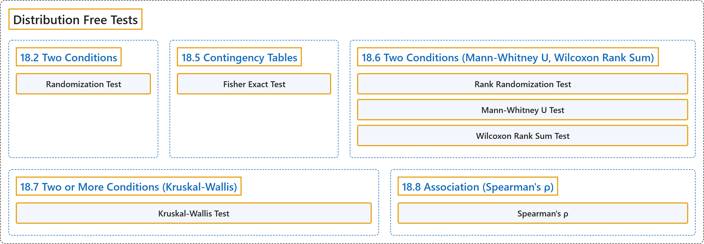

# 18 Distribution Free Tests

## Classification

## Glossary

| Term | Definition | 中文翻译 | Source |
|---|---|---|---|
| **18 Distribution Free Tests** 非参数检验 | (No definition) | （无定义） | [Online Statistics Education, n.d., chapter 18](https://onlinestatbook.com/2/distribution_free_tests/contents.html) |
| **18.2 Two Conditions** 两个条件 | (No definition) | （无定义） | [Online Statistics Education, n.d., section 18.2](https://onlinestatbook.com/2/distribution_free_tests/randomization_two.html) |
| **Randomization Test** 随机化检验 | "The approach taken by **randomization tests** is to consider **all possible ways** the values obtained in the experiment could be assigned to the two groups." | **随机化检验**的做法是考虑实验所得数值分配到两组的**所有可能方式**。 | [Online Statistics Education, n.d., section 18.2](https://onlinestatbook.com/2/distribution_free_tests/randomization_two.html) |
| **18.5 Contingency Tables** 列联表 | (No definition) | （无定义） | [Online Statistics Education, n.d., section 18.5](https://onlinestatbook.com/2/distribution_free_tests/randomization_contingency.html) |
| **Fisher Exact Test** 费希尔精确检验 | "The **Fisher Exact Test** is "exact" in the sense that it is **not based on a statistic that is approximately distributed** as, for example, Chi Square." | **费希尔精确检验**之所以称为“精确”，是因为它**不基于近似服从**某种分布（例如卡方分布）的统计量。 | [Online Statistics Education, n.d., section 18.5](https://onlinestatbook.com/2/distribution_free_tests/randomization_contingency.html) |
| **18.6 Two Conditions (Mann-Whitney U, Wilcoxon Rank Sum)** 两个条件（曼-惠特尼 U 检验、威尔科克森秩和检验） | (No definition) | （无定义） | [Online Statistics Education, n.d., section 18.6](https://onlinestatbook.com/2/distribution_free_tests/rank_two.html) |
| **Rank Randomization Test** 秩随机化检验 | "**Rank randomization tests** are performed by first **converting the scores to ranks** and then computing a randomization test." | **秩随机化检验**的做法是先**把分数转换为秩**，再进行随机化检验。 | [Online Statistics Education, n.d., section 18.6](https://onlinestatbook.com/2/distribution_free_tests/rank_two.html) |
| **Mann-Whitney U Test** 曼-惠特尼 U 检验 | "The two most common are the **Mann-Whitney U test** and the Wilcoxon Rank Sum test." | 最常用的两种是**曼-惠特尼 U 检验**和威尔科克森秩和检验。 | [Online Statistics Education, n.d., section 18.6](https://onlinestatbook.com/2/distribution_free_tests/rank_two.html) |
| **Wilcoxon Rank Sum Test** 威尔科克森秩和检验 | "The two most common are the Mann-Whitney U test and the **Wilcoxon Rank Sum test**." | 最常用的两种是曼-惠特尼 U 检验和**威尔科克森秩和检验**。 | [Online Statistics Education, n.d., section 18.6](https://onlinestatbook.com/2/distribution_free_tests/rank_two.html) |
| **18.7 Two or More Conditions (Kruskal-Wallis)** 两个或多个条件（克鲁斯卡尔-沃利斯检验） | (No definition) | （无定义） | [Online Statistics Education, n.d., section 18.7](https://onlinestatbook.com/2/distribution_free_tests/rank_two_or_more.html) |
| **Kruskal-Wallis Test** 克鲁斯卡尔-沃利斯检验 | "The **Kruskal-Wallis test** is a **rank-randomization test** that extends the Wilcoxon test to designs with more than two groups." | **克鲁斯卡尔-沃利斯检验**是一种**秩随机化检验**，它把威尔科克森检验推广到两组以上的设计。 | [Online Statistics Education, n.d., section 18.7](https://onlinestatbook.com/2/distribution_free_tests/rank_two_or_more.html) |
| **18.8 Association (Spearman's ρ)** 关联（斯皮尔曼 ρ） | (No definition) | （无定义） | [Online Statistics Education, n.d., section 18.8](https://onlinestatbook.com/2/distribution_free_tests/association.html) |
| **Spearman's ρ** 斯皮尔曼 ρ | "The **correlation of ranks** is called " **Spearman's** $\rho$."" | **秩的相关**称为“**斯皮尔曼** $\rho$”。 | [Online Statistics Education, n.d., section 18.8](https://onlinestatbook.com/2/distribution_free_tests/association.html) |

## References

*Online statistics education: An interactive multimedia course of study*. (n.d.). Rice University, University of Houston Clear Lake, and Tufts University. Retrieved October 29, 2026, from <https://onlinestatbook.com/2/>
