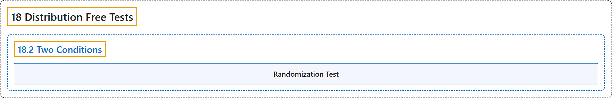

# 18.2 Two Conditions

## Classification

## Glossary

| Term | Definition | 中文翻译 | Source |
|---|---|---|---|
| **18.2 Two Conditions** 两个条件 | (No definition) | （无定义） | [Online Statistics Education, n.d., section 18.2](https://onlinestatbook.com/2/distribution_free_tests/randomization_two.html) |
| **Randomization Test** 随机化检验 | "The approach taken by **randomization tests** is to consider **all possible ways** the values obtained in the experiment could be assigned to the two groups." | **随机化检验**的做法是考虑实验所得数值分配到两组的**所有可能方式**。 | [Online Statistics Education, n.d., section 18.2](https://onlinestatbook.com/2/distribution_free_tests/randomization_two.html) |

## References

*Online statistics education: An interactive multimedia course of study*. (n.d.). Rice University, University of Houston Clear Lake, and Tufts University. Retrieved October 29, 2026, from <https://onlinestatbook.com/2/>
