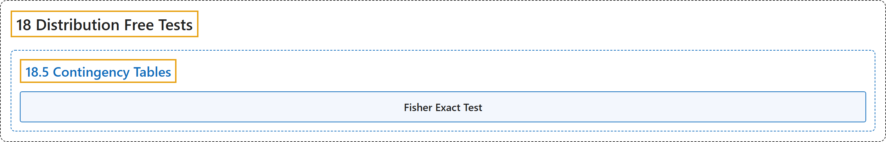

# 18.5 Contingency Tables

## Classification

## Glossary

| Term | Definition | 中文翻译 | Source |
|---|---|---|---|
| **18.5 Contingency Tables** 列联表 | (No definition) | （无定义） | [Online Statistics Education, n.d., section 18.5](https://onlinestatbook.com/2/distribution_free_tests/randomization_contingency.html) |
| **Fisher Exact Test** 费希尔精确检验 | "The **Fisher Exact Test** is "exact" in the sense that it is **not based on a statistic that is approximately distributed** as, for example, Chi Square." | **费希尔精确检验**之所以称为“精确”，是因为它**不基于近似服从**某种分布（例如卡方分布）的统计量。 | [Online Statistics Education, n.d., section 18.5](https://onlinestatbook.com/2/distribution_free_tests/randomization_contingency.html) |

## References

*Online statistics education: An interactive multimedia course of study*. (n.d.). Rice University, University of Houston Clear Lake, and Tufts University. Retrieved October 29, 2026, from <https://onlinestatbook.com/2/>
