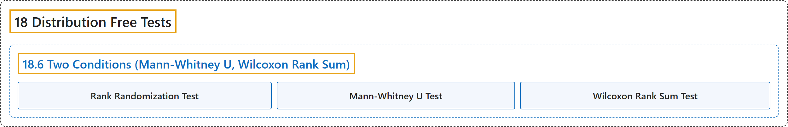

# 18.6 Two Conditions (Mann-Whitney U, Wilcoxon Rank Sum)

## Classification

## Glossary

| Term | Definition | 中文翻译 | Source |
|---|---|---|---|
| **18.6 Two Conditions (Mann-Whitney U, Wilcoxon Rank Sum)** 两个条件（曼-惠特尼 U 检验、威尔科克森秩和检验） | (No definition) | （无定义） | [Online Statistics Education, n.d., section 18.6](https://onlinestatbook.com/2/distribution_free_tests/rank_two.html) |
| **Rank Randomization Test** 秩随机化检验 | "**Rank randomization tests** are performed by first **converting the scores to ranks** and then computing a randomization test." | **秩随机化检验**的做法是先**把分数转换为秩**，再进行随机化检验。 | [Online Statistics Education, n.d., section 18.6](https://onlinestatbook.com/2/distribution_free_tests/rank_two.html) |
| **Mann-Whitney U Test** 曼-惠特尼 U 检验 | "The two most common are the **Mann-Whitney U test** and the Wilcoxon Rank Sum test." | 最常用的两种是**曼-惠特尼 U 检验**和威尔科克森秩和检验。 | [Online Statistics Education, n.d., section 18.6](https://onlinestatbook.com/2/distribution_free_tests/rank_two.html) |
| **Wilcoxon Rank Sum Test** 威尔科克森秩和检验 | "The two most common are the Mann-Whitney U test and the **Wilcoxon Rank Sum test**." | 最常用的两种是曼-惠特尼 U 检验和**威尔科克森秩和检验**。 | [Online Statistics Education, n.d., section 18.6](https://onlinestatbook.com/2/distribution_free_tests/rank_two.html) |

## References

*Online statistics education: An interactive multimedia course of study*. (n.d.). Rice University, University of Houston Clear Lake, and Tufts University. Retrieved October 29, 2026, from <https://onlinestatbook.com/2/>
