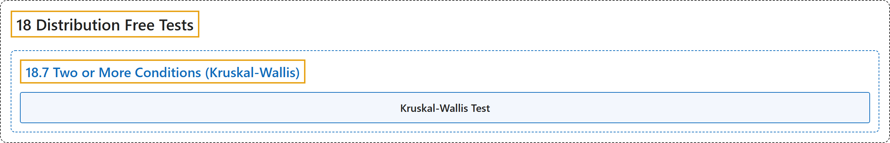

# 18.7 Two or More Conditions (Kruskal-Wallis)

## Classification

## Glossary

| Term | Definition | 中文翻译 | Source |
|---|---|---|---|
| **18.7 Two or More Conditions (Kruskal-Wallis)** 两个或多个条件（克鲁斯卡尔-沃利斯检验） | (No definition) | （无定义） | [Online Statistics Education, n.d., section 18.7](https://onlinestatbook.com/2/distribution_free_tests/rank_two_or_more.html) |
| **Kruskal-Wallis Test** 克鲁斯卡尔-沃利斯检验 | "The **Kruskal-Wallis test** is a **rank-randomization test** that extends the Wilcoxon test to designs with more than two groups." | **克鲁斯卡尔-沃利斯检验**是一种**秩随机化检验**，它把威尔科克森检验推广到两组以上的设计。 | [Online Statistics Education, n.d., section 18.7](https://onlinestatbook.com/2/distribution_free_tests/rank_two_or_more.html) |

## References

*Online statistics education: An interactive multimedia course of study*. (n.d.). Rice University, University of Houston Clear Lake, and Tufts University. Retrieved October 29, 2026, from <https://onlinestatbook.com/2/>
