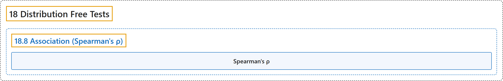

# 18.8 Association (Spearman's ρ)

## Classification

## Glossary

| Term | Definition | 中文翻译 | Source |
|---|---|---|---|
| **18.8 Association (Spearman's ρ)** 关联（斯皮尔曼 ρ） | (No definition) | （无定义） | [Online Statistics Education, n.d., section 18.8](https://onlinestatbook.com/2/distribution_free_tests/association.html) |
| **Spearman's ρ** 斯皮尔曼 ρ | "The **correlation of ranks** is called " **Spearman's** $\rho$."" | **秩的相关**称为“**斯皮尔曼** $\rho$”。 | [Online Statistics Education, n.d., section 18.8](https://onlinestatbook.com/2/distribution_free_tests/association.html) |

## References

*Online statistics education: An interactive multimedia course of study*. (n.d.). Rice University, University of Houston Clear Lake, and Tufts University. Retrieved October 29, 2026, from <https://onlinestatbook.com/2/>
