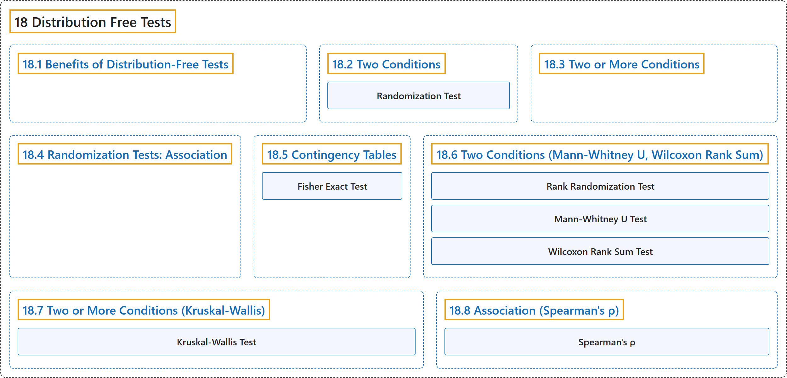

# 18 Distribution Free Tests

## Classification

## Glossary

| Term | Definition | 中文翻译 | Source |
|---|---|---|---|
| **18 Distribution Free Tests** 非参数检验 | (No definition) | （无定义） | [Online Statistics Education, n.d., chapter 18](https://onlinestatbook.com/2/distribution_free_tests/contents.html) |
| **[18.1 Benefits of Distribution-Free Tests](18-1-benefits-of-distribution-free-tests.md)** 非参数检验的优点 | (No definition) | （无定义） | [Online Statistics Education, n.d., section 18.1](https://onlinestatbook.com/2/distribution_free_tests/benefits.html) |
| **[18.2 Two Conditions](18-2-two-conditions.md)** 两个条件 | (No definition) | （无定义） | [Online Statistics Education, n.d., section 18.2](https://onlinestatbook.com/2/distribution_free_tests/randomization_two.html) |
| **[18.3 Two or More Conditions](18-3-two-or-more-conditions.md)** 两个或多个条件 | (No definition) | （无定义） | [Online Statistics Education, n.d., section 18.3](https://onlinestatbook.com/2/distribution_free_tests/randomization_two_or_more.html) |
| **[18.4 Randomization Tests: Association](18-4-randomization-tests-association.md)** 随机化检验：关联 | (No definition) | （无定义） | [Online Statistics Education, n.d., section 18.4](https://onlinestatbook.com/2/distribution_free_tests/randomization_association.html) |
| **[18.5 Contingency Tables](18-5-contingency-tables.md)** 列联表 | (No definition) | （无定义） | [Online Statistics Education, n.d., section 18.5](https://onlinestatbook.com/2/distribution_free_tests/randomization_contingency.html) |
| **[18.6 Two Conditions (Mann-Whitney U, Wilcoxon Rank Sum)](18-6-two-conditions-mann-whitney-u-wilcoxon-rank-sum.md)** 两个条件（曼-惠特尼 U 检验、威尔科克森秩和检验） | (No definition) | （无定义） | [Online Statistics Education, n.d., section 18.6](https://onlinestatbook.com/2/distribution_free_tests/rank_two.html) |
| **[18.7 Two or More Conditions (Kruskal-Wallis)](18-7-two-or-more-conditions-kruskal-wallis.md)** 两个或多个条件（克鲁斯卡尔-沃利斯检验） | (No definition) | （无定义） | [Online Statistics Education, n.d., section 18.7](https://onlinestatbook.com/2/distribution_free_tests/rank_two_or_more.html) |
| **[18.8 Association (Spearman's ρ)](18-8-association-spearman-s.md)** 关联（斯皮尔曼 ρ） | (No definition) | （无定义） | [Online Statistics Education, n.d., section 18.8](https://onlinestatbook.com/2/distribution_free_tests/association.html) |

## References

*Online statistics education: An interactive multimedia course of study*. (n.d.). Rice University, University of Houston Clear Lake, and Tufts University. Retrieved October 29, 2026, from <https://onlinestatbook.com/2/>
